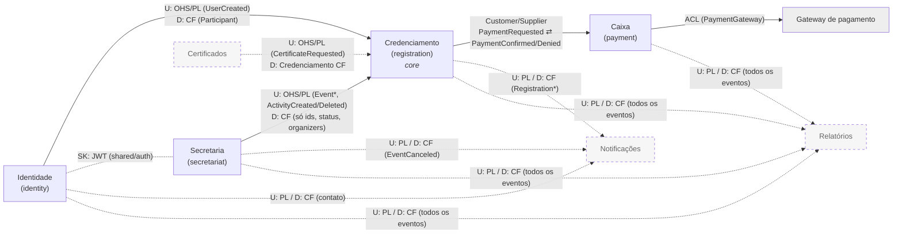
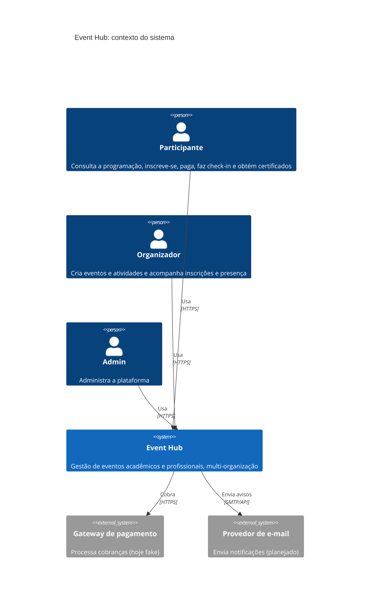
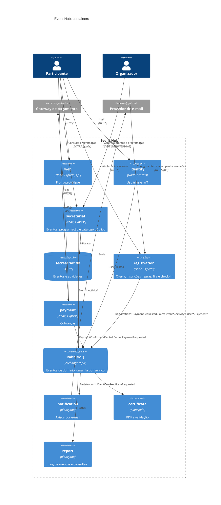

# Arquitetura: estado atual

Visão geral do que existe e do que falta. Detalhes em [ddd.md](ddd.md), [endpoint.md](endpoint.md), [adrs/](adrs/) e [../microservices/README.md](../microservices/README.md).

## Contextos

| Contexto | Serviço | RF | Estado |
|---|---|---|---|
| Identidade | `identity` | RF01 | Parcial |
| Secretaria | `secretariat` | RF02, RF03, RF04 (programação pública) | Pronto (SQLite); falta `/public` |
| Credenciamento | `registration` | RF04 (oferta pública), RF05, RF06, RF09 | Parcial |
| Caixa | `payment` | RF07 | Parcial |
| Notificações | — | RF08 | ADR 004 |
| Certificados | — | RF10 | ADR 003 |
| Relatórios | — | RF11 | ADR 005 |
| Monitoramento | — (infra) | — | ADR 006 |
| Front | `web` | — | Protótipo do fluxo, sem integração |

Não há serviço de catálogo: a programação pública fica na Secretaria e a oferta (preço, vagas, regras) no Credenciamento ([ADR 007](adrs/fronteiras-secretaria-credenciamento.md)).

## O que já temos

- **Infra:** docker-compose com um serviço por contêiner, hot reload no ambiente de dev e RabbitMQ com exchange `topic` e uma fila durável por serviço.
- **Comunicação:** coreografia por eventos ([ADR 001](adrs/comunicacao-assincrona.md)); cada serviço guarda projeções dos dados de outros contextos.
- **Auth:** JWT HS256 emitido pelo identity e validado em `shared/auth`; admin criado na subida.
- **Identity:** cadastro, login e o evento `UserCreated`.
- **Secretaria:** CRUD de eventos e atividades, publicar/cancelar, organizers, permissões e os eventos `Event*` e `Activity*`.
- **Credenciamento:** inscrição com regras (vaga, `minimumAge`, preço), pendências, saga de pagamento e projeções de atividade, evento e participante.
- **Caixa:** recebe `PaymentRequested`, paga por `POST /payments/:id/pay` com gateway fake e publica `PaymentConfirmed` ou `PaymentDenied`.
- **Testes:** secretariat, registration, payment e shared.
- **ADRs:** 001 a 007.

## O que falta

### Por contexto
- **Secretaria:** tirar `capacity`, `price` e `rules` (entidade, SQLite e mensagens) e criar os endpoints `/public` ([ADR 007](adrs/fronteiras-secretaria-credenciamento.md)).
- **Identity:** persistência (hoje em memória), hash de senha, `name` e `email` (pré-requisito de certificados e notificações) e `UserUpdated`.
- **Credenciamento:**
  - persistência (hoje em memória);
  - oferta (`PUT /activities/:id/offer`, `/public/activities/:id/offer`, `ActivityOfferUpdated`), conforme a ADR 007;
  - fila de acesso (`/queue`, websocket);
  - endpoints de organizador (listar e cancelar inscrições, `fulfill`);
  - quem resolva as pendências `wait list` e `age verification`;
  - check-in (`Attendance`, ticket, [ADR 002](adrs/checkin-no-registration.md));
  - emitir `CertificateRequested`.
- **Caixa:** auth, persistência, expiração da cobrança, estorno quando a inscrição é cancelada e gateway real (adaptador).
- **Notificações, Certificados e Relatórios:** criar, conforme os ADRs.
- **Web:** integrar com as APIs, ou com um API gateway/BFF. A tela de atividade compõe programação (Secretaria) e oferta (Credenciamento).

### Transversal
- **Mensageria:**
  - outbox, porque a publicação não é transacional com o banco;
  - DLQ, porque hoje um handler que falha confirma a mensagem e ela se perde;
  - `id` e `occurredAt` em toda mensagem, para idempotência e relatórios;
  - id de correlação;
  - contratos versionados (AsyncAPI).
- **Monitoramento:** `/health`, logs estruturados, métricas e tracing ([ADR 006](adrs/monitoramento.md)).
- **Segurança:** RS256 no lugar do segredo compartilhado.
- **Entrada única:** API gateway na frente dos serviços (hoje cada um expõe sua porta).
- **Docs:** status dos ADRs (todos "Proposto" ou em branco), numeração duplicada (001) e exchange chamado `loja`.

## Context map

`U` = upstream, `D` = downstream, `OHS` = Open Host Service, `PL` = Published Language, `CF` = Conformist, `ACL` = Anti-Corruption Layer, `SK` = Shared Kernel. Tracejado = planejado.

- **Credenciamento** é o core domain. Identidade, Notificações, Certificados e Relatórios são genéricos, e Caixa é de suporte.
- **Secretaria** é dona da programação; o **Credenciamento**, da oferta (capacidade, preço, regras). A projeção entre eles leva só ids, status e organizers ([ADR 007](adrs/fronteiras-secretaria-credenciamento.md)).
- **Certificados** é upstream: define a própria mensagem de entrada, e o credenciamento se conforma a ela ([ADR 003](adrs/certificados.md)).
- **Shared Kernel:** `microservices/shared` (bus, auth, repositórios). É acoplamento consciente, porque uma mudança ali afeta todos os serviços.

## C4: nível 1, contexto

## C4: nível 2, containers

O C4 de nível 3 (componentes) vale a pena só para o `registration`, onde está o domínio core: `Activity` (aggregate com a oferta e factory das inscrições), `Registration`, regras, `Attendance`, app service e as projeções.
