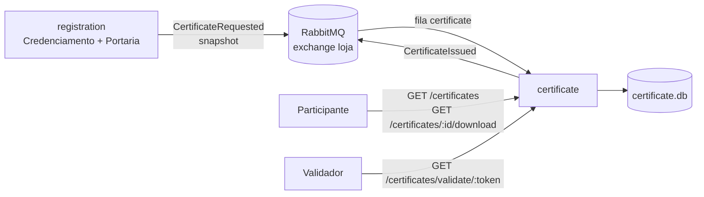

# Plano de implementação — Microserviço de Certificados

> Baseado em [docs/endpoint.md](../endpoint.md), seção `## Certificado`, e no modelo de
> [docs/ddd.md](../ddd.md) e [docs/diagrams/arquitetura.md](../diagrams/arquitetura.md).
> A implementação atual está em `microservices/certificate` (Python 3.13, FastAPI, SQLite).
> A seção 15 traz requisições de exemplo e o roteiro de teste manual.
>
> **Decisão de arquitetura (revisada):** a emissão é **orientada a evento**. O
> `registration` valida a elegibilidade e publica `CertificateRequested`; o `certificate`
> consome da fila `certificate` e cria o certificado. **Não existe chamada HTTP entre os
> dois serviços.** O `POST /events/:eventId/certificates` continua existindo apenas como
> consulta de "já foi emitido?".

## 1. Escopo

O serviço `certificate` (porta **3005**) é responsável por:

- consumir `CertificateRequested` e emitir o certificado de forma **idempotente**;
- persistir o certificado e o token de verificação em SQLite;
- listar certificados do participante autenticado;
- expor metadados, validação pública por token e download em PDF;
- publicar `CertificateIssued` (best-effort) após criar.

Fica **fora do escopo**: decidir elegibilidade, criar inscrição, registrar presença e
autenticar o usuário. O `registration` é dono de inscrições/presenças e da regra de
elegibilidade; o `identity` é dono da autenticação. O `certificate` não lê o banco de outro
serviço e não mantém projeções: ele recebe um snapshot pronto no evento.

## 2. Big picture



Fluxo principal:

1. O participante tem inscrição `confirmed` e pelo menos uma presença.
2. O `registration` monta o snapshot e publica `CertificateRequested` no exchange `loja`
   (routing key `CertificateRequested`), depois do commit.
3. O `certificate` consome a mensagem da fila `certificate`.
4. `certificateService.criar(evento)` valida o payload, cria o certificado e persiste.
5. Se criou agora, publica `CertificateIssued` (best-effort).
6. O participante consulta `GET /certificates`, baixa o PDF e terceiros validam pelo token.
7. `POST /events/:eventId/certificates` apenas informa se o certificado já existe.

### Estado atual do repositório (relevante)

- `microservices/certificate/` está implementado em Python, com 37 testes.
- O `registration` **ainda não publica** `CertificateRequested`.
- O `identity` ainda não emite JWT; o token é gerado manualmente em dev.
- O bus Node (`shared/messaging/rabbitmq-message-bus.js`) usa exchange `loja` (topic),
  fila durável por serviço e `prefetch(1)`, mas dá `ack` mesmo quando o handler falha.
  O consumer Python **não** copia esse comportamento (ver §3.3).
- O `shared/sqlite.js` já oferece `outbox`/`inbox`, ainda pouco usados.

Consequência: o `certificate` está pronto para o evento, mas o fluxo real ponta a ponta
depende de o `registration` implementar a publicação (e o `identity`, o JWT).

## 3. Decisões de arquitetura

### 3.1 Onde fica a emissão

**Decidido: no `certificate`, disparada por evento.**

- O `certificate` é dono do recurso certificado e da API de certificados.
- A elegibilidade fica no `registration`, que é dono dos dados.
- O evento carrega o snapshot completo, então o `certificate` não precisa perguntar nada.
- O `POST` existente passa a ser uma consulta de prontidão: `200` se já existe,
  `404` se o evento ainda não chegou. Ele **não** cria e **não** chama o `registration`.

Trade-off: a emissão deixa de ser síncrona do ponto de vista do cliente. O certificado
"aparece" quando o evento é consumido. Em troca, não há dependência de disponibilidade em
tempo de requisição e o acoplamento entre os serviços é só o contrato do evento.

### 3.2 Regra de elegibilidade (no `registration`, sem percentual)

- **Inscrição aprovada** = `Registration.status === 'confirmed'`, em atividade de evento
  `published` e não cancelado.
- **Presença** = existe `UserCheckedIn` para o mesmo `userId` + `activityId`.
- **Elegível** se há pelo menos uma inscrição confirmada **e** pelo menos uma presença em
  atividade com inscrição confirmada.
- **Sem percentual mínimo e sem cálculo de frequência.**
- **Atividades do certificado** = atividades com inscrição confirmada **e** presença,
  ordenadas por `startsAt`.
- Evento `draft`, `canceled` ou deletado → não publica.
- Certificado é por **participante + evento** (`UNIQUE(user_id, event_id)`), não por
  atividade.
- Só publica **depois do commit** (idealmente via `outbox`).

O `certificate` **não duplica** essa política: se o evento chegou, ele confia.

> Decisão em aberto: exigir que o evento já tenha terminado (`endDate < now`).
> Recomendação: **não exigir por padrão**, deixando configurável no `registration`
> (`CERTIFICATE_REQUIRE_EVENT_ENDED=false`).

### 3.3 Consistência, reentrega e falhas

- **Idempotência**: `UNIQUE(user_id, event_id)` + `add_or_get`. Reentrega devolve o mesmo
  certificado e **não** republica `CertificateIssued`.
- **Corrida**: duas mensagens simultâneas para o mesmo par geram uma linha só; a segunda
  encontra o registro existente.
- **Payload inválido** (JSON quebrado, campo faltando, data com hora, `activities` vazia):
  `nack(requeue=False)` — mensagem envenenada não entra em loop. O erro é logado.
- **Erro transitório** (banco travado, publisher): `nack(requeue=True)` — reentrega.
- **Ack só depois do commit** do certificado.
- **Primeiro escritor vence**: se o payload do evento e algum dado antigo divergirem, o
  certificado existente é preservado.
- `CertificateIssued` é best-effort: se o RabbitMQ falhar, loga e segue. Para entrega
  garantida, usar `outbox` (§5.2).

### 3.4 Autenticação

- O cliente autentica com `Authorization: Bearer <JWT>` **ou** cookie `token`.
- Claims mínimas: `userId` (ou `sub`); `role` opcional.
- `GET /certificates` filtra pelo `userId` do token.
- `GET /certificates/:id` e `/download` só para o dono ou admin.
- `GET /certificates/validate/:token` é público, sem JWT.
- Não existe mais `X-Internal-Token` nem chamada interna a autenticar.

## 4. Contratos

### 4.1 Evento consumido — `CertificateRequested`

Fila `certificate`, exchange `loja` (topic), routing key `CertificateRequested`,
mensagens persistentes, `prefetch(1)`.

```json
{
  "type": "CertificateRequested",
  "participantId": "user-1",
  "participantName": "Maria Silva",
  "eventId": "event-1",
  "eventName": "Congresso X",
  "eventDate": "2026-11-07",
  "activities": [{ "name": "Minicurso A" }, { "name": "Palestra B" }]
}
```

| Campo | Obrigatório | Regra no `certificate` |
|---|---|---|
| `type` | não | se presente, precisa ser `CertificateRequested` |
| `participantId` | sim | string não vazia; vira `user_id` |
| `participantName` | sim | string não vazia |
| `eventId` | sim | string não vazia |
| `eventName` | sim | string não vazia |
| `eventDate` | sim | `YYYY-MM-DD` válido; data com hora é rejeitada |
| `activities` | sim | lista não vazia; cada item com `name` não vazio |

O `certificate` gera `id`, `verificationToken` e `issuedAt`.

### 4.2 Evento publicado — `CertificateIssued`

| Evento | Payload | Quando |
|---|---|---|
| `CertificateIssued` | `{ certificateId, participantId, eventId, verificationToken, issuedAt }` | após persistir um certificado novo |

Opcional para o fluxo HTTP; útil para Notificações/UI.

### 4.3 API HTTP

- `POST /events/:eventId/certificates` → `200 { certificateId }` ou `404`.
- `GET /certificates` → lista do usuário do JWT.
- `GET /certificates/:id` → metadados (dono/admin).
- `GET /certificates/:id/download` → PDF (dono/admin).
- `GET /certificates/validate/:token` → validação pública.
- `GET /health` → `{ status, database }`.

## 5. Modelo de dados (SQLite)

Banco próprio: `certificate/data/certificate.db` (ou `CERTIFICATE_DATA_DIR`), sem leitura do
banco de outro serviço.

### 5.1 Tabela principal

```sql
CREATE TABLE IF NOT EXISTS certificates (
    id                 TEXT PRIMARY KEY,
    user_id            TEXT NOT NULL,
    event_id           TEXT NOT NULL,
    participant_name   TEXT NOT NULL,
    event_name         TEXT NOT NULL,
    event_date         TEXT NOT NULL,          -- ISO date (YYYY-MM-DD)
    activities         TEXT NOT NULL,          -- JSON: [{"name":"..."}]
    verification_token TEXT NOT NULL UNIQUE,
    created_at         TEXT NOT NULL,          -- ISO UTC
    UNIQUE (user_id, event_id)
);

CREATE INDEX IF NOT EXISTS idx_certificates_user ON certificates(user_id);
CREATE INDEX IF NOT EXISTS idx_certificates_token ON certificates(verification_token);
```

- `participant_name`, `event_name`, `event_date` e `activities` são **snapshots**; mudanças
  posteriores não reescrevem o certificado.
- `event_date` usa a data de início do evento.
- `activities` em JSON evita tabela filha para um dado imutável e pequeno.
- Não há tabela de projeção nem `inbox`: o serviço só consome `CertificateRequested`, e a
  idempotência por `(user_id, event_id)` já cobre reentrega.

### 5.2 Outbox opcional

Se `CertificateIssued` precisar de entrega garantida, usar a tabela `outbox` do
`shared/sqlite.js` ou uma equivalente:

```sql
CREATE TABLE IF NOT EXISTS outbox (
    id     TEXT PRIMARY KEY,
    evento TEXT NOT NULL
);
```

Publicação após o commit, com job simples de retry. Para o MVP, log e best-effort bastam.

## 6. API do serviço

Erros: `400` validação, `401` não autenticado, `403` sem permissão, `404` inexistente,
`500` interno.

### `POST /events/:eventId/certificates` — prontidão

- Auth obrigatória (o próprio participante).
- `200 { certificateId }` se o certificado já foi emitido.
- `404 { "error": "certificate not available" }` se o evento ainda não foi consumido.
- Não cria nada e não consulta o `registration`.

### `GET /certificates` — lista do participante

- Auth obrigatória; filtro `user_id = req.user.id`.
- `200`:

```json
[
  { "certificateId": "uuid", "eventName": "Congresso X", "eventDate": "2026-11-07" }
]
```

### `GET /certificates/:id` — metadados

- Auth obrigatória; dono ou admin.
- `200`:

```json
{
  "id": "uuid",
  "participantName": "Maria Silva",
  "eventName": "Congresso X",
  "eventDate": "2026-11-07",
  "activities": [{ "name": "Minicurso A" }, { "name": "Palestra B" }],
  "verificationToken": "opaque-token",
  "issuedAt": "2026-11-08T12:00:00.000Z"
}
```

- `403` se o certificado é de outro usuário; `404` se não existe.

### `GET /certificates/:id/download` — PDF

- Auth obrigatória; dono ou admin.
- Gera o PDF sob demanda com **ReportLab** (não persiste o arquivo).
- Headers: `Content-Type: application/pdf`,
  `Content-Disposition: attachment; filename="certificado-<slug>.pdf"`,
  `Cache-Control: no-store`.
- Conteúdo: título, nome, evento e data, atividades, texto de autenticidade, token e URL de
  validação (`PUBLIC_BASE_URL/certificates/validate/<token>`), QR Code e data de emissão.

### `GET /certificates/validate/:token` — validação pública

- Sem auth; busca por `verification_token`.
- `200`:

```json
{
  "valid": true,
  "participantName": "Maria Silva",
  "eventName": "Congresso X",
  "eventDate": "2026-11-07",
  "activities": [{ "name": "Minicurso A" }],
  "issuedAt": "2026-11-08T12:00:00.000Z"
}
```

- `404` para token inexistente. Não expor `userId`, `eventId` nem dados de contato.
- `Cache-Control: no-store`; rate limit é recomendado.

## 7. Estrutura de arquivos

```text
microservices/certificate/
├── Dockerfile
├── requirements.txt / requirements-dev.txt
├── app/
│   ├── main.py                 # uvicorn
│   ├── factory.py              # wiring + lifespan (publisher/consumer)
│   ├── config.py
│   ├── domain/
│   │   ├── certificate.py      # entidade imutável, token, validação
│   │   └── errors.py
│   ├── application/
│   │   ├── events.py           # contrato do CertificateRequested
│   │   └── certificate_service.py
│   ├── infrastructure/
│   │   ├── database.py         # SQLite
│   │   ├── consumer.py         # aio-pika, ack/nack
│   │   ├── event_publisher.py  # CertificateIssued (best-effort)
│   │   └── pdf_generator.py
│   └── http/
│       ├── auth.py
│       ├── routes.py
│       └── schemas.py
├── dev/
│   └── publish_certificate_requested.py
└── tests/
    ├── test_domain.py
    ├── test_repository.py
    ├── test_service_event.py
    ├── test_consumer.py
    ├── test_pdf_generator.py
    └── test_api.py
```

Do lado do `registration`, a implementação futura precisa de:

```text
microservices/registration/src/application/certificate-requested.publisher.js
# monta o snapshot e publica via messageBus.publish({ type: "CertificateRequested", ... })
```

## 8. Fases de implementação

### Fase 0 — Fechar contratos (concluída)

- Contrato do `CertificateRequested` definido (payload e validações do §4.1).
- `POST` redefinido como consulta de prontidão.
- `CertificateRequested` é o gatilho; `CertificateIssued` é opcional.

### Fase 1 — `certificate` (concluída)

- Domínio, SQLite, consumer, publisher, API, PDF e validação pública.
- Testes automatizados cobrindo evento, reentrega, payload inválido, API e PDF.

### Fase 2 — `registration` publica `CertificateRequested` (pendente)

- Aplicar a regra do §3.2 (inscrição confirmada + presença).
- Montar o snapshot com `participantId`, `participantName`, `eventId`, `eventName`,
  `eventDate` e `activities` (somente com presença, ordenadas por `startsAt`).
- Publicar **depois do commit**, com `type: "CertificateRequested"`.
- Ideal: `outbox` para não perder evento entre commit e publish.
- Testes: elegível publica; sem inscrição/presença não publica; evento cancelado não publica.

**Aceite:** com o consumer do `certificate` no ar, um check-in válido faz o certificado
aparecer em `GET /certificates` sem nenhuma chamada HTTP entre serviços.

### Fase 3 — JWT no `identity` (pendente)

- Emitir JWT no login (`userId`, `role` opcional) com o mesmo `JWT_SECRET`.
- Definir cookie/token conforme o `endpoint.md`.
- Testar `401` sem token e `200` com token.

### Fase 4 — Hardening e operação (parcial)

- Health com estado do banco e do consumer.
- Logs com `eventType`, `participantId`, `eventId`, `certificateId`.
- DLQ para mensagens inválidas (hoje: `nack(requeue=False)` + log).
- `outbox` para `CertificateIssued` se notificações forem críticas.
- Rate limit na validação pública.

**Aceite:** restart do `certificate` não perde certificados; mensagens inválidas não entram
em loop; `/health` reflete o banco.

## 9. Estratégia de testes

| Nível | O que cobrir |
|---|---|
| Unitário (domínio) | token, snapshots imutáveis, serialização, validações |
| Unitário (aplicação) | `criar` mapeia o payload, idempotência, não republica, payload inválido |
| Unitário (consumer) | `ack` no sucesso, `nack(False)` no inválido, `nack(True)` no transitório |
| Integração (SQLite) | schema, `UNIQUE(user_id,event_id)`, lookup por token, persistência |
| API | `200/404` de prontidão, GETs `200/401/403/404`, PDF `%PDF`, validação pública |
| Contrato | payload do `CertificateRequested` e do `CertificateIssued` |
| E2E manual | RabbitMQ → publicar evento → listar → baixar → validar token |

Ferramenta: `python -m pytest`. O consumer é testado sem broker, com uma mensagem fake.

## 10. Configuração e operação

### `certificate`

| Variável | Exemplo | Uso |
|---|---|---|
| `PORT` | `3005` | porta HTTP |
| `RABBITMQ_URL` | `amqp://rabbitmq` | consumo de `CertificateRequested` e publicação de `CertificateIssued` |
| `JWT_SECRET` | segredo compartilhado | validação do token do usuário |
| `PUBLIC_BASE_URL` | `http://localhost:3005` | URL no PDF/QR |
| `CERTIFICATE_DATA_DIR` / `DADOS` | `data` | diretório do SQLite |

Sem `RABBITMQ_URL`, a API sobe mas **não consome eventos** — nenhum certificado é emitido.

### `registration` (futuro)

| Variável | Exemplo | Uso |
|---|---|---|
| `RABBITMQ_URL` | `amqp://rabbitmq` | publicação de `CertificateRequested` |
| `CERTIFICATE_REQUIRE_EVENT_ENDED` | `false` | regra opcional de evento terminado |

Compose (como está hoje):

```yaml
certificate:
  <<: *service            # herda RABBITMQ_URL, JWT_SECRET e depends_on rabbitmq
  build: { context: ., dockerfile: certificate/Dockerfile }
  environment:
    <<: *env
    PORT: &certificate-port 3005
    PUBLIC_BASE_URL: http://localhost:3005
  ports: [{ published: *certificate-port, target: *certificate-port }]
  volumes:
    - certificate-data:/app/data
```

Operação:

- Suba o `certificate` **antes** de o `registration` publicar: o exchange é topic e
  mensagens sem fila ligada são descartadas.
- A fila `certificate` é durável; se o serviço cair, mensagens esperam.
- SQLite é arquivo compartilhado: rodar **uma instância** do serviço. Competing consumers
  exigiriam outro banco (Postgres) antes de escalar réplicas.

## 11. Riscos e mitigação

| Risco | Impacto | Mitigação |
|---|---|---|
| `registration` publica antes do binding existir | evento perdido | subir `certificate` antes; `outbox` no `registration` |
| Evento com payload inválido | loop de reentrega | validação defensiva + `nack(requeue=False)` + log/DLQ |
| Evento publicado antes do commit | certificado fantasma | publicar depois do commit/outbox |
| Reentrega / duplicidade | certificado duplicado | `UNIQUE(user_id,event_id)` + `add_or_get` |
| Múltiplas réplicas com SQLite | corrupção/lock | uma instância; migrar para Postgres antes de escalar |
| JWT ainda não existe | serviço não autentica | Fase 3; token manual em dev |
| `registration` não implementa a regra | nenhum certificado emitido | Fase 2; testes de elegibilidade no `registration` |
| Regra duplicada | divergência | política só no `registration` |
| `CertificateIssued` perdido | notificação não sai | `outbox` se crítico |
| PDF com acentos quebrados | artefato ruim | testar fonte; já coberto por teste de PDF |
| Token vazado | exposição de nome/evento | token de alta entropia, resposta mínima, `no-store`, rate limit |
| Dados pessoais na validação | LGPD | só nome/evento/atividades; nunca `userId`/`eventId`/contato |

## 12. Perguntas em aberto (com recomendação)

1. **`POST` deve continuar existindo?** → sim, como prontidão (`200/404`). Remover só se o
   front passar a usar exclusivamente `GET /certificates`.
2. **`CertificateRequested` carrega tudo?** → sim; evita chamada reversa. Se o payload
   crescer, versionar o contrato (`version`).
3. **Evento precisa ter terminado?** → não por padrão; configurável no `registration`.
4. **Cancelar/deletar evento revoga certificados?** → manter os já emitidos; bloquear novos
   no `registration`.
5. **PDF com QR Code?** → sim, apontando para a URL de validação.
6. **`CertificateIssued` é obrigatório?** → não para o fluxo; sim se Notificações dependerem.

## 13. Definição de pronto (DoD)

- [x] `docker compose up -d --build certificate` sobe na porta 3005.
- [x] O `certificate` consome `CertificateRequested` da fila `certificate`.
- [x] `certificateService.criar` mapeia o snapshot e persiste de forma idempotente.
- [x] Reentrega não duplica certificado nem republica `CertificateIssued`.
- [x] Payload inválido é descartado sem loop; erro transitório é reenfileirado.
- [x] `POST` responde `200` com o id ou `404` quando ainda não emitido.
- [x] `GET /certificates` lista somente os certificados do usuário do JWT.
- [x] `GET /certificates/:id` e `/download` exigem dono/admin; `/validate/:token` é público.
- [x] PDF contém nome, evento, data, atividades, token e URL/QR de validação.
- [x] Token de verificação é único, imprevisível e indexado.
- [x] Certificados e tokens sobrevivem a restart.
- [x] Testes passando (`python -m pytest`).
- [x] `README.md`, `docs/endpoint.md` e compose atualizados.
- [ ] `registration` publica `CertificateRequested` (Fase 2).
- [ ] `identity` emite JWT (Fase 3).

## 14. Ordem sugerida (caminho crítico)

```text
Fase 0 (contratos)  ✔
   └─> Fase 1 (certificate)  ✔
          └─> Fase 2 (registration publica CertificateRequested)
                 └─> Fase 3 (JWT no identity)
                        └─> Fase 4 (hardening: DLQ, outbox, rate limit)
```

## 15. Requisições de exemplo e teste manual

Pré-requisitos: Python 3.13, dependências do serviço e um RabbitMQ acessível. O `identity`
ainda não emite JWT, então o token é gerado manualmente com o mesmo `JWT_SECRET`.

### 15.1 Subir o RabbitMQ

```powershell
cd microservices
docker compose up -d rabbitmq
docker compose ps rabbitmq
```

A UI de gestão fica em `http://localhost:15673` (`guest`/`guest`). Se você já tem um
RabbitMQ local, use `amqp://localhost`.

### 15.2 Subir o serviço

```powershell
cd microservices\certificate

python -m venv .venv
.\.venv\Scripts\Activate.ps1
python -m pip install -r requirements-dev.txt

$env:RABBITMQ_URL="amqp://localhost"
$env:JWT_SECRET="dev-secret-com-pelo-menos-32-bytes"
$env:PUBLIC_BASE_URL="http://127.0.0.1:3005"
$env:CERTIFICATE_DATA_DIR=".\data"

python -m uvicorn app.main:app --host 127.0.0.1 --port 3005 --reload
```

Saída esperada (além do Uvicorn):

```text
consuming CertificateRequested from queue certificate on loja
```

Se a execução de scripts estiver bloqueada no PowerShell:

```powershell
Set-ExecutionPolicy -Scope Process Bypass
```

O banco fica em `data/certificate.db`. Para começar do zero, pare o serviço e apague
`.\data`.

### 15.3 Gerar um JWT manualmente

```powershell
$TOKEN = python -c "import jwt; print(jwt.encode({'userId': 'user-1'}, 'dev-secret-com-pelo-menos-32-bytes', algorithm='HS256'))"
```

Admin (para acessar certificado de outro usuário):

```powershell
$ADMIN = python -c "import jwt; print(jwt.encode({'userId': 'admin', 'role': 'admin'}, 'dev-secret-com-pelo-menos-32-bytes', algorithm='HS256'))"
```

### 15.4 Health check

```powershell
curl.exe -i http://127.0.0.1:3005/health
```

Esperado: `200 {"status":"ok","database":"ok"}`.

### 15.5 Publicar `CertificateRequested`

Em outro terminal, a partir de `microservices\certificate`:

```powershell
$env:RABBITMQ_URL="amqp://localhost"
python dev\publish_certificate_requested.py --participant-id user-1 --event-id event-1
```

O script declara exchange, fila e binding, então pode rodar antes ou depois do serviço. Ele
imprime o payload publicado. O serviço deve logar:

```text
CertificateRequested processed certificateId=<uuid> created=True
```

Para conferir a idempotência, publique duas vezes:

```powershell
python dev\publish_certificate_requested.py --participant-id user-1 --event-id event-1 --repeat 2
```

O segundo processamento loga `created=False` e **não** republica `CertificateIssued`.

Parâmetros úteis: `--participant-name`, `--event-name`, `--event-date`, `--activity`
(repetível), `--url`.

Sem RabbitMQ, use o modo direto (grava no mesmo SQLite do serviço):

```powershell
python dev\publish_certificate_requested.py --direct
```

### 15.6 Consultar a lista

```powershell
Invoke-RestMethod -Uri "http://127.0.0.1:3005/certificates" `
  -Headers @{ Authorization = "Bearer $TOKEN" } |
  ConvertTo-Json -Depth 5
```

Esperado:

```json
[
  {
    "certificateId": "<uuid>",
    "eventName": "Congresso X",
    "eventDate": "2026-11-07"
  }
]
```

Guarde o id:

```powershell
$cid = (Invoke-RestMethod -Uri "http://127.0.0.1:3005/certificates" `
  -Headers @{ Authorization = "Bearer $TOKEN" })[0].certificateId
$cid
```

### 15.7 Prontidão (`POST`)

```powershell
curl.exe -i -X POST "http://127.0.0.1:3005/events/event-1/certificates" -H "Authorization: Bearer $TOKEN"
# 200 {"certificateId":"<uuid>"}

curl.exe -i -X POST "http://127.0.0.1:3005/events/event-999/certificates" -H "Authorization: Bearer $TOKEN"
# 404 {"error":"certificate not available"}
```

O `POST` não cria nada: para o `event-999` aparecer, publique um evento com
`--event-id event-999`.

### 15.8 Metadados e validação pública

```powershell
$meta = Invoke-RestMethod -Uri "http://127.0.0.1:3005/certificates/$cid" `
  -Headers @{ Authorization = "Bearer $TOKEN" }
$meta | ConvertTo-Json -Depth 5
$vtoken = $meta.verificationToken

Invoke-RestMethod -Uri "http://127.0.0.1:3005/certificates/validate/$vtoken" |
  ConvertTo-Json -Depth 5
```

Esperado: `valid: true`, nome/evento/data/atividades e `issuedAt`. A resposta **não** contém
`userId`, `eventId` nem o token. Também pode abrir no navegador:

```text
http://127.0.0.1:3005/certificates/validate/<verificationToken>
```

### 15.9 Baixar o PDF

```powershell
Invoke-WebRequest `
  -Uri "http://127.0.0.1:3005/certificates/$cid/download" `
  -Headers @{ Authorization = "Bearer $TOKEN" } `
  -OutFile ".\certificado.pdf"

Get-Item .\certificado.pdf | Select-Object Name, Length
Start-Process .\certificado.pdf
```

O PDF deve abrir com nome, evento, data, atividades, token, URL e QR Code de validação.

### 15.10 Erros e autorização

Sem token:

```powershell
curl.exe -i http://127.0.0.1:3005/certificates
# 401 {"error":"unauthorized"}
```

Outro usuário:

```powershell
$OTHER = python -c "import jwt; print(jwt.encode({'userId': 'user-2'}, 'dev-secret-com-pelo-menos-32-bytes', algorithm='HS256'))"
curl.exe -i "http://127.0.0.1:3005/certificates/$cid" -H "Authorization: Bearer $OTHER"
# 403
```

Admin:

```powershell
curl.exe -i "http://127.0.0.1:3005/certificates/$cid" -H "Authorization: Bearer $ADMIN"
# 200
```

Token inválido:

```powershell
curl.exe -i http://127.0.0.1:3005/certificates -H "Authorization: Bearer not-a-jwt"
# 401 {"error":"invalid token"}
```

Payload inválido (data com hora): a mensagem é descartada sem criar nada. O serviço loga
`discarding invalid CertificateRequested ... eventDate must be an ISO date`.

```powershell
python dev\publish_certificate_requested.py --participant-id user-9 --event-id event-bad --event-date "2026-11-07T10:00:00Z"
```

Confirme que `GET /certificates` com um JWT de `user-9` continua vazio:

```powershell
$FRESH = python -c "import jwt; print(jwt.encode({'userId': 'user-9'}, 'dev-secret-com-pelo-menos-32-bytes', algorithm='HS256'))"
Invoke-RestMethod -Uri "http://127.0.0.1:3005/certificates" -Headers @{ Authorization = "Bearer $FRESH" }
```

### 15.11 Checklist rápido

| Verificação | Esperado |
|---|---|
| `GET /health` | `200 {"status":"ok","database":"ok"}` |
| Serviço loga `consuming CertificateRequested` | consumer conectado |
| Publicar evento | `created=True` no log |
| `GET /certificates` | certificado listado |
| `POST /events/event-1/certificates` | `200` com o id |
| `POST` de evento inexistente | `404 certificate not available` |
| Publicar o mesmo evento 2x | `created=False`, sem duplicata |
| `GET /certificates/{id}` | metadados e `verificationToken` |
| `GET /certificates/validate/{token}` | `valid: true`, sem JWT |
| `GET /certificates/{id}/download` | PDF `%PDF` que abre |
| Sem JWT | `401` |
| Outro usuário | `403` |
| Admin | `200` |
| Payload inválido | mensagem descartada, nada criado |

### 15.12 Testes automatizados

```powershell
cd microservices\certificate
python -m pytest -v
```

Esperado: **37 passed**.

| Arquivo | O que cobre |
|---|---|
| `tests/test_domain.py` | token, imutabilidade e validações da entidade |
| `tests/test_repository.py` | SQLite, idempotência e persistência após reconexão |
| `tests/test_service_event.py` | `criar`, mapeamento do payload, idempotência e payloads inválidos |
| `tests/test_consumer.py` | `ack`/`nack`, JSON quebrado, payload inválido, reentrega |
| `tests/test_pdf_generator.py` | PDF válido e nome de arquivo seguro |
| `tests/test_api.py` | prontidão, listagem, metadados, PDF, validação e autorização |

### 15.13 Docker Compose

```powershell
cd microservices
docker compose up -d --build rabbitmq certificate
docker compose logs -f certificate
curl.exe -i http://localhost:3005/health
```

Para publicar um evento no broker do compose, a partir do host:

```powershell
cd microservices\certificate
$env:RABBITMQ_URL="amqp://localhost:5672"
python dev\publish_certificate_requested.py --participant-id user-1 --event-id event-1
```

O compose injeta `RABBITMQ_URL=amqp://rabbitmq` no serviço e mantém a fila durável.

> O fluxo real ponta a ponta (check-in → evento → certificado) só funciona quando o
> `registration` implementar a publicação descrita na Fase 2.
