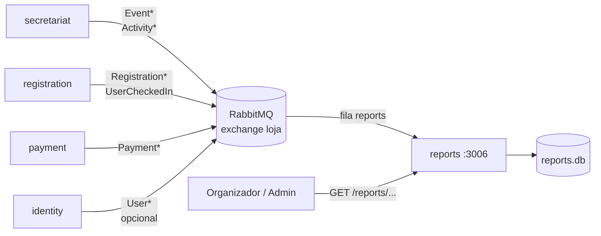

# Plano de implementação — Microserviço de Monitoramento e Relatórios

> Baseado em [docs/endpoint.md](../endpoint.md), seção `## Monitoramente e relatórios`,
> em [docs/ddd.md](../ddd.md) (`Relatorio`) e em
> [docs/diagrams/usecase.puml](../diagrams/usecase.puml) (`RF11UC1`).
> A implementação de referência é o `microservices/certificate` (Python 3.13, FastAPI,
> SQLite, RabbitMQ), que já resolve consumer, JWT, PDF e testes.
>
> **Decisão de arquitetura:** o `reports` é um **read model (CQRS)**. Ele não lê o banco
> de outro serviço e não faz chamada HTTP para `secretariat`, `registration`, `payment`
> ou `identity`. Ele consome eventos do RabbitMQ, mantém projeções locais em SQLite e
> responde relatórios a partir dessas projeções.

## 0. Resumo executivo

| Decisão | Escolha |
|---|---|
| Serviço | `reports`, porta **3006** |
| Stack | a mesma do `certificate`: Python 3.13 + FastAPI + SQLite + aio-pika + PyJWT + ReportLab (+ `openpyxl` para XLSX) |
| Integração | somente eventos RabbitMQ (fila `reports`); **sem HTTP entre serviços** |
| Consistência | projeções locais (CQRS), `UPSERT` idempotente e `dataUpdatedAt` |
| Autorização | JWT + `event.organizers`; admin por `role` ou allowlist |
| Saída | JSON (padrão), CSV, XLSX e PDF sob demanda |
| Bloqueio atual | publishers ainda não emitem `Registration*`/`UserCheckedIn`/pagamentos completos |

Caminho crítico: **Fase 0 (contratos/publishers) → Fase 1 (núcleo JSON) → Fase 2 (exports)
→ Fase 3 (lista de presença) → Fase 4 (hardening) → Fase 5 (E2E)**.

## 1. Escopo

O serviço `reports` (porta **3006**) é responsável por:

- consumir eventos de eventos, atividades, inscrições, pagamentos, presenças e
  participantes;
- manter projeções locais somente leitura para consulta e exportação;
- expor indicadores de **inscrições, ocupação, comparecimento e pagamentos** por evento e
  por atividade;
- gerar exports em **JSON, CSV, XLSX e PDF** sob demanda;
- listar participantes/presenças (lista de presença) para organizadores;
- autorizar o acesso por `event.organizers` ou `admin`;
- informar a idade dos dados (`generatedAt`, `dataUpdatedAt`) e o estado do consumer em
  `/health`.

Fica **fora do escopo**:

- criar/editar eventos, atividades, inscrições, pagamentos ou presenças;
- decidir elegibilidade, emitir certificado, autenticar usuário;
- enviar notificações ou disparar alertas operacionais;
- dashboards em tempo real via WebSocket/SSE (MVP usa polling no JSON);
- event store/replay histórico (ver §12, risco de projeção incompleta).

O `reports` é **descartável e reconstruível em tese**, mas no estado atual do repositório
não existe event store para replay. Isso é tratado em §3.5 e §12.

## 2. Big picture



Fluxo principal:

1. Os serviços donos publicam eventos de domínio no exchange `loja` (topic).
2. O `reports` consome da fila durável `reports` e aplica cada evento nas projeções.
3. O organizador autentica com JWT e consulta `GET /reports/events/:id` ou
   `GET /reports/activities/:id`.
4. O serviço valida `event.organizers`/`admin`, calcula os indicadores a partir do SQLite
   e devolve JSON ou gera o arquivo pedido (`CSV`, `XLSX`, `PDF`).
5. O relatório carrega `generatedAt` (quando foi calculado) e `dataUpdatedAt` (último
   evento aplicado), deixando explícita a consistência eventual.

### Estado atual do repositório (relevante)

- `microservices/certificate` é a única implementação Python e o melhor molde para o
  `reports`: FastAPI + SQLite + `aio-pika` + consumer com `ack/nack` correto + PyJWT +
  ReportLab + pytest.
- O bus Node (`shared/messaging/rabbitmq-message-bus.js`) usa exchange `loja`, fila durável
  por serviço e `prefetch(1)`, mas dá `ack` mesmo quando o handler falha. O consumer
  Python do `certificate` **não** copia esse comportamento e é o modelo a seguir.
- `shared/sqlite.js` já tem `inbox`/`outbox`, mas quase não são usados.
- O `secretariat` emite apenas `EventCreated`/`EventUpdated` com payloads parciais
  (`capacity`, `activity`), diferentes do contrato de `docs/endpoint.md`.
- O `registration` atual **não publica** `Registration*`/`UserCheckedIn`.
- O `payment` emite `PaymentConfirmed`/`PaymentDenied` sem `registrationId` nem `amount`.
- O `identity` ainda não emite JWT; o token é gerado manualmente em dev.
- O `docs/endpoint.md` define `GET /reports/events/:id` e `/reports/activities/:id` com
  apenas três totais; o restante do contrato é proposto neste plano.

Consequência: a arquitetura do `reports` pode começar já, mas o fluxo real ponta a ponta
depende de a Fase 0 (contratos) e os publishers evoluírem. O serviço deve tolerar payloads
parciais e eventos fora de ordem desde o primeiro dia.

## 3. Decisões de arquitetura

### 3.1 Read model local (CQRS), orientado a evento

**Decidido: projeções locais em SQLite, alimentadas por eventos.**

- O `reports` é dono apenas do seu banco `reports.db`; não lê `secretariat.db`,
  `registration.db`, `payment.db` nem `identity.db`.
- Não existe chamada HTTP síncrona entre `reports` e os outros serviços.
- Cada evento é aplicado com `UPSERT` idempotente; os indicadores são consultas SQL sobre
  as projeções, não contadores incrementais soltos.
- A autorização também vem da projeção: `EventCreated`/`EventUpdated` carregam
  `organizers`.

Trade-off: os relatórios são **eventualmente consistentes**. Em troca, não há acoplamento
de disponibilidade nem leitura cruzada de banco.

### 3.2 Por que não consultar os serviços na hora

- Criaria dependência de N serviços disponíveis para um único relatório.
- Repetiria regras de negócio que pertencem a cada dono.
- Misturaria autorização de `secretariat` com autorização de `registration`.
- Impediria relatório histórico: se a atividade mudar de capacidade/preço, o passado
  precisa continuar legível.

O `reports` guarda **snapshots** dos campos necessários. Eventos posteriores atualizam a
projeção; relatórios já emitidos não são reescritos.

### 3.3 Contrato de mensagem (envelope)

Todos os eventos passam a aceitar um envelope opcional e retrocompatível:

```json
{
  "messageId": "4f3c2b1a-...",
  "type": "RegistrationConfirmed",
  "occurredAt": "2026-11-08T12:00:00.000Z",
  "version": 1,
  "registrationId": "reg-1",
  "userId": "user-1"
}
```

| Campo | Obrigatório | Uso |
|---|---|---|
| `messageId` | não | deduplicação na tabela `inbox`; se ausente, o `UPSERT` natural resolve |
| `type` | sim | roteamento e validação |
| `occurredAt` | não | ordenação; sem ele, usa o `received_at` do consumer |
| `version` | não | evolução futura do payload |
| campos de domínio | sim | conforme §4 |

> Atenção: `eventId` continua sendo o **id do evento de negócio**. O id da mensagem é
> `messageId`, para não colidir com o payload de `EventCreated`.

### 3.4 Idempotência, ordem e estados terminais

- **Idempotência**: toda escrita é `INSERT ... ON CONFLICT ... DO UPDATE/DO NOTHING`.
  Reentrega não duplica inscrição, presença, pagamento nem evento.
- **`inbox`**: quando `messageId` existe, ele é gravado na mesma transação; mensagem
  repetida é ignorada.
- **Fora de ordem**: cada linha guarda `source_at` (o `occurredAt` normalizado). Uma
  mensagem mais antiga que a já aplicada é ignorada.
- **Estados terminais**:
  - `Event.status`: `canceled` é terminal; `EventUpdated` não reabre.
  - `Activity`: `deleted_at` é terminal.
  - `Registration.status`: `canceled` é terminal; um `RegistrationConfirmed` atrasado não
    ressuscita a inscrição. Precedência: `canceled > confirmed > pending`.
  - `Payment.status`: `approved`/`denied` são terminais; `requested` é o inicial.
- **Presença**: `UNIQUE(activity_id, user_id)`; o primeiro `UserCheckedIn` vence e
  preserva o `checkedInAt` original. Check-in repetido é no-op.
- **Relação evento↔atividade**: `RegistrationCreated`/`UserCheckedIn` podem chegar antes
  de `ActivityCreated`. Nesse caso `event_id` fica nulo e é preenchido quando a atividade
  chega (ver §3.5). Também é recomendado incluir `eventId` nesses eventos.

### 3.5 Tolerância a eventos incompletos e reconstrução

- O consumer **não derruba** o serviço por payload parcial: campos ausentes ficam nulos e
  o relatório mostra o que existe.
- Campos obrigatórios (ids e `type`) ausentes → `nack(requeue=False)` + log. O evento é
  descartado para não travar a fila.
- **Relink**: ao aplicar `ActivityCreated/Updated`, o serviço preenche
  `registrations.event_id` e `attendances.event_id` que estejam nulos para aquela
  `activity_id`.
- **Sem replay**: RabbitMQ não guarda histórico depois do `ack`. Se o `reports` subir
  depois de os eventos terem sido consumidos por outros, a projeção nasce incompleta.
  Mitigações:
  - subir o `reports` **antes** de publicar/operar os eventos;
  - `dev/seed_report.py` para demonstração e testes;
  - no futuro, um `outbox`/event log no produtor ou um store de eventos para reconstruir
    projeções.

### 3.6 Autorização

- `Authorization: Bearer <JWT>` ou cookie `token`, igual ao `certificate`.
- Claims mínimas: `userId` (ou `sub`/`id`); `role` opcional.
- **Organizador** = `userId` presente em `events.organizers` da projeção.
- **Admin** = `role == "admin"`, se o JWT tiver role. Como `docs/endpoint.md` diverge
  (o topo fala em `role`, a seção de identidade diz que o JWT não tem role), o serviço
  aceita também uma allowlist `REPORTS_ADMIN_USER_IDS`.
- Evento/atividade inexistente na projeção ou deletado → `404`.
- Usuário autenticado que não é organizador nem admin → `403`.
- Relatórios contêm dados pessoais (nome/email na lista de presença). Nada é público além
  de `/health`. `Cache-Control: no-store` em todas as respostas de relatório.

### 3.7 Geração de arquivos

- Geração **sob demanda**, sem persistir arquivo e sem cache no MVP.
- JSON é o formato padrão; `format` aceita `json|csv|xlsx|pdf` (case-insensitive).
- Formato inválido → `400`.
- Geração de XLSX/PDF roda em threadpool (`run_in_threadpool`), como o PDF do
  `certificate`, para não bloquear o event loop.
- CSV: UTF-8 com BOM, uma tabela achatada com coluna `secao` (`resumo`, `atividade`,
  `participante`, `pagamento`).
- XLSX: abas `Resumo`, `Atividades`, `Participantes`, `Pagamentos` (as duas últimas só se
  solicitadas).
- PDF: A4 paisagem, resumo + tabelas, rodapé com `generatedAt` e número de página.
- Limites do MVP: JSON de participantes paginado (`page`, `limit` padrão 100, máximo
  1000); exports completos com teto de 10.000 linhas → `413` acima disso (evolução:
  geração assíncrona).

### 3.8 Stack

**Decidido: a mesma stack do `microservices/certificate`.** Não introduzir runtime, banco
ou framework novos. O `reports` é outro serviço Python com o mesmo desenho de wiring,
configuração, consumer, autenticação e testes.

| Camada | Tecnologia | Origem |
|---|---|---|
| Runtime | Python 3.13 (`python:3.13-slim`) | `certificate/Dockerfile` |
| HTTP | FastAPI `0.115.14` + Uvicorn `0.38.0` | `certificate/requirements.txt` |
| Auth | PyJWT `2.15.1` (HS256) | `certificate/requirements.txt` |
| Banco | SQLite (stdlib `sqlite3`), `WAL` | `certificate/app/infrastructure/database.py` |
| Mensageria | aio-pika `10.2.2` | `certificate/requirements.txt` |
| PDF | ReportLab `5.1.0` | `certificate/requirements.txt` |
| Testes | pytest `>=8` + httpx `>=0.27` | `certificate/requirements-dev.txt` |
| Container | `python:3.13-slim`, usuário não-root, `uvicorn` | `certificate/Dockerfile` |

A **única dependência nova** é `openpyxl` (para o requisito `XLSX` de
`docs/endpoint.md`), porque o `certificate` só gera PDF. Ela não altera a arquitetura, o
runtime nem o padrão de testes. `qrcode[pil]` do `certificate` **não** é necessário aqui e
não deve ser incluído.

Consequências positivas:

- mesmo `factory.py`/`Settings.from_env`/lifespan do `certificate`;
- mesmo consumer `aio-pika` com `ack`/`nack` correto e reconexão;
- mesmo `auth.py` (Bearer ou cookie) e mesmas classes de erro;
- mesmo padrão de testes (`pytest`, `httpx`, consumer testado sem broker);
- mesmo Dockerfile/compose, mudando apenas porta, diretório de dados e dependências.

## 4. Contratos

### 4.1 Eventos consumidos

Fila `reports`, exchange `loja` (topic), mensagens persistentes, `prefetch(1)`.
Bindings para todos os `type` abaixo.

| Evento | Campos usados | Obrigatórios | Ação na projeção |
|---|---|---|---|
| `EventCreated` | `eventId`, `name`, `information`, `startDate`, `endDate`, `status`, `organizers` | `eventId`, `name` | upsert evento; `status` padrão `draft` |
| `EventUpdated` | idem, parciais | `eventId` | atualiza só campos presentes; `organizers` substitui a lista |
| `EventPublished` | `eventId`, `status`, `organizers` | `eventId` | `status = published` |
| `EventCanceled` | `eventId`, `reason`, `status` | `eventId` | `status = canceled`, `cancel_reason` |
| `EventDeleted` | `eventId` | `eventId` | soft delete (`deleted_at`) |
| `ActivityCreated` | `activityId`, `eventId`, `name`, `description`, `location`, `startsAt`, `endsAt`, `capacity`, `price`, `rules` | `activityId`, `eventId`, `name` | upsert atividade; relink de inscrições/presenças |
| `ActivityUpdated` | idem, parciais | `activityId` | atualiza só campos presentes |
| `ActivityDeleted` | `activityId` | `activityId` | soft delete |
| `RegistrationCreated` | `id`, `userId`, `activityId`, `eventId?`, `status`, `requirements`, `reasons` | `id`, `userId`, `activityId` | upsert inscrição; precedência de status |
| `RegistrationConfirmed` | `registrationId`, `userId`, `eventId?` | `registrationId` | `status = confirmed` |
| `RegistrationCanceled` | `registrationId`, `userId`, `reason`, `eventId?` | `registrationId` | `status = canceled`, motivo |
| `PaymentRequested` | `paymentId`, `registrationId`, `userId`, `amount`, `description` | `paymentId`, `registrationId`, `amount` | upsert pagamento `requested` |
| `PaymentApproved` **ou** `PaymentConfirmed` | `paymentId`, `registrationId?`, `amount?` | `paymentId` | `status = approved`; aceitar os dois nomes |
| `PaymentDenied` | `paymentId`, `registrationId?`, `reason` | `paymentId` | `status = denied`, motivo |
| `UserCheckedIn` | `activityId`, `userId`, `eventId?`, `checkedInAt` | `activityId`, `userId`, `checkedInAt` | insert idempotente de presença |
| `UserCreated`/`UserUpdated` (opcional) | `userId`, `name`, `email` | `userId` | upsert participante (nome/email para a lista) |

Observações de contrato:

- `price`/`amount` chegam como número decimal; o banco guarda **centavos** (`int`) para
  evitar erro de ponto flutuante.
- `organizers` é lista de `userId`. `EventUpdated` sem `organizers` não apaga a lista;
  `organizers: []` apaga.
- `UserCreated`/`UserUpdated` é opcional: sem ele, a lista mostra `userId` e o relatório
  continua correto. Recomendado para a lista de presença ter nome/email.
- **Divergências atuais a corrigir na Fase 0**:
  - `payment` emite `PaymentConfirmed`, não `PaymentApproved`, e sem `registrationId`/
    `amount`. O `reports` aceita ambos os nomes, mas não consegue atribuir o pagamento à
    inscrição sem `registrationId`. Padronizar o evento ou incluir os campos.
  - `secretariat` emite `EventCreated { capacity }` e `EventUpdated { activity }`, fora do
    contrato de `docs/endpoint.md`.
  - `registration` ainda não publica `RegistrationCreated/Confirmed/Canceled` nem
    `UserCheckedIn`.
  - `identity` ainda não emite JWT.

### 4.2 API HTTP

Base: `http://localhost:3006`. Todas as rotas de relatório exigem JWT.

| Método | Rota | Auth | Descrição |
|---|---|---|---|
| `GET` | `/reports/events/{eventId}` | organizador/admin | Relatório do evento; `?format=json\|csv\|xlsx\|pdf` |
| `GET` | `/reports/activities/{activityId}` | organizador/admin | Relatório da atividade; `?format=...` |
| `GET` | `/reports/events/{eventId}/participants` | organizador/admin | Lista de presença/inscrições; filtros e export |
| `GET` | `/health` | pública | Status do banco e do consumer |

Rotas de participantes e filtros são **extensões propostas** para atender à "lista de
presença" do DDD; as duas primeiras são as exigidas por `docs/endpoint.md`.

Query params comuns:

| Param | Onde | Valores | Padrão |
|---|---|---|---|
| `format` | todas | `json`, `csv`, `xlsx`, `pdf` | `json` |
| `include` | evento | `activities,participants,payments` (CSV de itens) | `activities` |
| `activityId` | participantes | id da atividade | todos |
| `status` | participantes | `pending,confirmed,canceled` (CSV) | todos |
| `checkedIn` | participantes | `true`, `false` | todos |
| `page` | participantes JSON | inteiro ≥ 1 | `1` |
| `limit` | participantes JSON | 1..1000 | `100` |

Códigos de erro: `400` formato/filtro inválido, `401` não autenticado, `403` sem
permissão, `404` evento/atividade inexistente ou deletado, `413` export acima do limite,
`500` interno.

### 4.3 Formato JSON do relatório de evento

```json
{
  "event": {
    "id": "event-1",
    "name": "Congresso X",
    "startDate": "2026-11-07",
    "endDate": "2026-11-09",
    "status": "published"
  },
  "generatedAt": "2026-11-10T18:00:00.000Z",
  "dataUpdatedAt": "2026-11-10T17:59:58.000Z",

  "totalRegistrations": 110,
  "totalRegistrationsConfirmed": 100,
  "totalAttendances": 80,

  "totals": {
    "registrations": {
      "all": 120,
      "active": 110,
      "pending": 10,
      "confirmed": 100,
      "canceled": 10
    },
    "capacity": 150,
    "occupancyRate": 66.67,
    "attendanceRate": 80.0,
    "noShowRate": 20.0
  },

  "payments": {
    "requested": 40,
    "approved": 35,
    "denied": 5,
    "expectedAmount": 4000.0,
    "approvedAmount": 3500.0,
    "currency": "BRL"
  },

  "activities": [
    {
      "id": "act-1",
      "name": "Minicurso A",
      "location": "Sala 1",
      "startsAt": "2026-11-07T10:00:00.000Z",
      "endsAt": "2026-11-07T12:00:00.000Z",
      "capacity": 30,
      "price": 100.0,
      "totalRegistrations": 38,
      "totalRegistrationsConfirmed": 35,
      "totalAttendances": 30,
      "registrations": {
        "all": 40,
        "active": 38,
        "pending": 3,
        "confirmed": 35,
        "canceled": 2
      },
      "occupancyRate": 116.67,
      "attendanceRate": 85.71
    }
  ],

  "participants": [
    {
      "registrationId": "reg-1",
      "userId": "user-1",
      "name": "Maria Silva",
      "email": "maria@example.com",
      "activityId": "act-1",
      "status": "confirmed",
      "checkedInAt": "2026-11-07T10:05:00.000Z",
      "paymentStatus": "approved"
    }
  ]
}
```

- Os três campos `total*` no topo mantêm compatibilidade literal com `docs/endpoint.md`.
- `participants` e `payments` só aparecem se `include` pedir.
- `dataUpdatedAt` é o maior `updated_at`/`source_at` das linhas envolvidas.

### 4.4 Formato JSON do relatório de atividade

```json
{
  "activity": {
    "id": "act-1",
    "eventId": "event-1",
    "name": "Minicurso A",
    "description": "Introdução a X",
    "location": "Sala 1",
    "startsAt": "2026-11-07T10:00:00.000Z",
    "endsAt": "2026-11-07T12:00:00.000Z",
    "capacity": 30,
    "price": 100.0,
    "rules": ["Maiores de 18 anos"]
  },
  "event": { "id": "event-1", "name": "Congresso X" },
  "generatedAt": "2026-11-10T18:00:00.000Z",
  "dataUpdatedAt": "2026-11-10T17:59:58.000Z",
  "totalRegistrations": 38,
  "totalRegistrationsConfirmed": 35,
  "totalAttendances": 30,
  "registrations": {
    "all": 40,
    "active": 38,
    "pending": 3,
    "confirmed": 35,
    "canceled": 2
  },
  "occupancyRate": 116.67,
  "attendanceRate": 85.71,
  "noShowRate": 14.29,
  "participants": [
    {
      "registrationId": "reg-1",
      "userId": "user-1",
      "name": "Maria Silva",
      "email": "maria@example.com",
      "status": "confirmed",
      "checkedInAt": "2026-11-07T10:05:00.000Z",
      "paymentStatus": "approved"
    }
  ]
}
```

### 4.5 Definições dos indicadores

| Indicador | Definição |
|---|---|
| `registrations.all` | todas as inscrições recebidas, inclusive canceladas |
| `registrations.active` | `pending + confirmed` (não canceladas) |
| `registrations.pending` | `status = pending` |
| `registrations.confirmed` | `status = confirmed` |
| `registrations.canceled` | `status = canceled` |
| `totalRegistrations` | alias de `registrations.active` (compatível com o endpoint.md) |
| `totalRegistrationsConfirmed` | alias de `registrations.confirmed` |
| `totalAttendances` | presenças distintas por `(activity_id, user_id)` |
| `capacity` (evento) | soma das capacidades das atividades não deletadas |
| `occupancyRate` (atividade) | `confirmed / capacity * 100`; `capacity = 0` ⇒ `null` |
| `occupancyRate` (evento) | `soma(confirmed das atividades) / soma(capacity das atividades) * 100`; é uma taxa por **vaga-atividade**, não por pessoa |
| `attendanceRate` (atividade) | `attendances / confirmed * 100`; `confirmed = 0` ⇒ `null` |
| `attendanceRate` (evento) | `usuários distintos com presença / usuários distintos com inscrição confirmada * 100`; evita passar de 100% quando a pessoa participa de várias atividades |
| `noShowRate` | `100 - attendanceRate` (na mesma granularidade); `null` se `attendanceRate` for `null` |
| `payments.requested` | pagamentos com `status = requested` |
| `payments.approved` | pagamentos com `status = approved` |
| `payments.denied` | pagamentos com `status = denied` |
| `payments.expectedAmount` | soma de `amount` de `PaymentRequested` |
| `payments.approvedAmount` | soma de `amount` de `PaymentApproved`/`PaymentConfirmed` |

Percentuais são arredondados em 2 casas. `price`/`amount` saem como decimal (`centavos / 100`);
internamente são inteiros.

### 4.6 Formatos de export

**CSV** — `text/csv; charset=utf-8`, BOM `\ufeff`, `Content-Disposition: attachment`.
Colunas fixas, com `secao` para separar blocos:

```csv
secao,id,nome,status,inicio,fim,capacidade,inscricoes_ativas,confirmadas,canceladas,pendentes,presencas,taxa_ocupacao,taxa_presenca,valor
resumo,event-1,Congresso X,published,2026-11-07,2026-11-09,150,110,100,10,10,80,66.67,80.00,
atividade,act-1,Minicurso A,,2026-11-07T10:00:00Z,2026-11-07T12:00:00Z,30,38,35,2,3,30,116.67,85.71,100.00
participante,reg-1,Maria Silva,confirmed,,,,,,,,,,,,
```

**XLSX** — `application/vnd.openxmlformats-officedocument.spreadsheetml.sheet`.
Abas: `Resumo`, `Atividades`, `Participantes` (se `include`), `Pagamentos` (se `include`).
Cabeçalho em negrito, painel congelado, largura automática, percentuais como número.

**PDF** — `application/pdf`, A4 paisagem, `ReportLab`:
- cabeçalho com nome do evento/atividade e período;
- tabela de resumo (inscrições, ocupação, presenças, pagamentos);
- tabela por atividade (evento) ou por participante (atividade);
- rodapé com `generatedAt` e paginação.

**JSON** — `application/json`, corpo conforme §4.3/§4.4.

Todos os exports: `Cache-Control: no-store` e `X-Report-Updated-At: <dataUpdatedAt>`.
Nome do arquivo: `relatorio-evento-<slug>-<YYYYMMDD>.<ext>` ou
`relatorio-atividade-<slug>-<YYYYMMDD>.<ext>`; `slug` sem acentos, minúsculo, máx. 60.

## 5. Modelo de dados (SQLite)

Banco próprio: `reports/data/reports.db` (ou `REPORTS_DATA_DIR`/`DADOS`). Sem leitura do
banco de outro serviço. `PRAGMA journal_mode = WAL`.

```sql
CREATE TABLE IF NOT EXISTS events (
    id            TEXT PRIMARY KEY,
    name          TEXT NOT NULL,
    information   TEXT,
    start_date    TEXT,
    end_date      TEXT,
    status        TEXT NOT NULL DEFAULT 'draft',
    cancel_reason TEXT,
    organizers    TEXT NOT NULL DEFAULT '[]',   -- JSON: ["user-1"]
    source_at     TEXT,                         -- occurredAt normalizado
    updated_at    TEXT NOT NULL,
    deleted_at    TEXT
);

CREATE TABLE IF NOT EXISTS activities (
    id          TEXT PRIMARY KEY,
    event_id    TEXT NOT NULL,
    name        TEXT NOT NULL,
    description TEXT,
    location    TEXT,
    starts_at   TEXT,
    ends_at     TEXT,
    capacity    INTEGER NOT NULL DEFAULT 0,
    price_cents INTEGER NOT NULL DEFAULT 0,
    rules       TEXT NOT NULL DEFAULT '[]',     -- JSON: ["..."]
    source_at   TEXT,
    updated_at  TEXT NOT NULL,
    deleted_at  TEXT
);
CREATE INDEX IF NOT EXISTS idx_activities_event ON activities(event_id);

CREATE TABLE IF NOT EXISTS registrations (
    id           TEXT PRIMARY KEY,
    event_id     TEXT,                          -- pode ser preenchido no relink
    activity_id  TEXT NOT NULL,
    user_id      TEXT NOT NULL,
    status       TEXT NOT NULL DEFAULT 'pending',
    requirements TEXT NOT NULL DEFAULT '[]',    -- JSON
    reasons      TEXT NOT NULL DEFAULT '[]',    -- JSON
    source_at    TEXT,
    updated_at   TEXT NOT NULL
);
CREATE INDEX IF NOT EXISTS idx_registrations_event ON registrations(event_id);
CREATE INDEX IF NOT EXISTS idx_registrations_activity ON registrations(activity_id);
CREATE INDEX IF NOT EXISTS idx_registrations_user ON registrations(user_id);

CREATE TABLE IF NOT EXISTS attendances (
    activity_id   TEXT NOT NULL,
    user_id       TEXT NOT NULL,
    event_id      TEXT,
    checked_in_at TEXT NOT NULL,
    source_at     TEXT,
    PRIMARY KEY (activity_id, user_id)
);
CREATE INDEX IF NOT EXISTS idx_attendances_event ON attendances(event_id);

CREATE TABLE IF NOT EXISTS payments (
    id              TEXT PRIMARY KEY,
    registration_id TEXT,
    user_id         TEXT,
    amount_cents    INTEGER NOT NULL DEFAULT 0,
    status          TEXT NOT NULL DEFAULT 'requested',
    description     TEXT,
    reason          TEXT,
    source_at       TEXT,
    updated_at      TEXT NOT NULL
);
CREATE INDEX IF NOT EXISTS idx_payments_registration ON payments(registration_id);

CREATE TABLE IF NOT EXISTS participants (
    id         TEXT PRIMARY KEY,
    name       TEXT,
    email      TEXT,
    updated_at TEXT NOT NULL
);

CREATE TABLE IF NOT EXISTS inbox (
    message_id  TEXT PRIMARY KEY,
    type        TEXT NOT NULL,
    received_at TEXT NOT NULL
);
```

Decisões:

- **Sem foreign keys** nas projeções: eventos podem chegar fora de ordem
  (`RegistrationCreated` antes de `ActivityCreated`). A integridade é garantida pelo
  `UPSERT` e pelo relink.
- **`source_at`** guarda o `occurredAt` normalizado em UTC (`...Z`); serve para ignorar
  mensagens antigas.
- **Soft delete** (`deleted_at`) preserva o histórico e permite auditoria; por padrão o
  relatório de evento/atividade deletado responde `404`. `?includeDeleted=true` fica como
  evolução para admin.
- **JSON em `organizers`/`rules`/`requirements`/`reasons`** evita tabelas filhas para dados
  pequenos e imutáveis.
- **`price_cents`/`amount_cents`** evitam float.
- **`participants`** é opcional e alimentado por `UserCreated`/`UserUpdated`.
- **`inbox`** é a deduplicação por `messageId`; sem `messageId`, o `UPSERT` natural já
  garante idempotência.

## 6. API do serviço

Erros no formato `{ "error": "...", "reasons": [...] }`.

### `GET /reports/events/{eventId}`

- Auth obrigatória; organizador do evento ou admin.
- `format=json` (padrão): corpo de §4.3.
- `format=csv|xlsx|pdf`: arquivo com os headers de §4.6.
- `include=activities,participants,payments`: controla seções (o padrão inclui
  `activities`).
- `404` se o evento não existe na projeção ou está deletado.
- `403` se o usuário não é organizador/admin.

### `GET /reports/activities/{activityId}`

- Auth obrigatória; organizador do evento pai ou admin.
- `format=json` (padrão): corpo de §4.4.
- `format=csv|xlsx|pdf`: arquivo.
- `include=participants`.
- `404` se a atividade não existe ou está deletada.

### `GET /reports/events/{eventId}/participants`

- Auth obrigatória; organizador/admin.
- Filtros: `activityId`, `status` (CSV), `checkedIn=true|false`.
- JSON paginado:

```json
{
  "items": [
    {
      "registrationId": "reg-1",
      "userId": "user-1",
      "name": "Maria Silva",
      "email": "maria@example.com",
      "activityId": "act-1",
      "activityName": "Minicurso A",
      "status": "confirmed",
      "checkedInAt": "2026-11-07T10:05:00.000Z",
      "paymentStatus": "approved"
    }
  ],
  "page": 1,
  "limit": 100,
  "total": 1
}
```

- `format=csv|xlsx|pdf` exporta a lista completa (respeitando os filtros), com teto de
  10.000 linhas.

### `GET /health`

```json
{
  "status": "ok",
  "database": "ok",
  "consumer": {
    "connected": true,
    "queue": "reports",
    "exchange": "loja",
    "lastEventAt": "2026-11-10T17:59:58.000Z",
    "lastMessageType": "UserCheckedIn"
  }
}
```

- `status` é `degraded` se o banco falhar ou o consumer estiver desconectado com
  `RABBITMQ_URL` configurada.
- Sem `RABBITMQ_URL`, o serviço sobe, a API responde, mas nada é projetado.

## 7. Estrutura de arquivos

```text
microservices/reports/
├── Dockerfile
├── requirements.txt
├── requirements-dev.txt
├── pytest.ini
├── README.md
├── app/
│   ├── __init__.py
│   ├── main.py                     # uvicorn
│   ├── factory.py                  # wiring + lifespan (repository, consumer)
│   ├── config.py                   # Settings.from_env
│   ├── domain/
│   │   ├── errors.py               # AppError/400/401/403/404/413
│   │   ├── models.py               # dataclasses das projeções
│   │   └── metrics.py              # cálculo de totais, taxas e agregações
│   ├── application/
│   │   ├── events.py               # parse/validação de cada tipo de evento
│   │   ├── projections.py          # apply(event) -> upserts + relink + inbox
│   │   └── reports_service.py      # autorização, consulta e montagem do relatório
│   ├── infrastructure/
│   │   ├── database.py             # schema, UPSERTs, consultas, inbox
│   │   ├── consumer.py             # aio-pika, ack/nack, reconexão
│   │   └── exporters/
│   │       ├── csv_exporter.py
│   │       ├── xlsx_exporter.py
│   │       └── pdf_exporter.py
│   └── http/
│       ├── auth.py                 # JWT (Bearer ou cookie)
│       ├── routes.py
│       └── schemas.py              # Pydantic de saída
├── dev/
│   ├── seed_report.py              # popula o SQLite direto (sem broker)
│   └── publish_events.py           # publica os eventos de exemplo no RabbitMQ
└── tests/
    ├── test_projections.py
    ├── test_consumer.py
    ├── test_metrics.py
    ├── test_reports_service.py
    ├── test_exporters.py
    └── test_api.py
```

Do lado dos publishers, a Fase 0 precisa de:

```text
microservices/secretariat/src/...   # EventCreated/Updated/Published/Canceled/Deleted completos
microservices/registration/src/...  # RegistrationCreated/Confirmed/Canceled e UserCheckedIn
microservices/payment/src/...       # PaymentRequested/Approved|Confirmed/Denied com registrationId/amount
microservices/identity/src/...      # JWT e, opcionalmente, UserCreated/UserUpdated
```

## 8. Fases de implementação

### Fase 0 — Fechar contratos e documentação (bloqueante para o E2E)

- Definir o envelope `messageId`/`occurredAt` (opcional) no bus compartilhado.
- Padronizar `Event*`/`Activity*` no `secretariat` conforme §4.1.
- Implementar a publicação de `RegistrationCreated/Confirmed/Canceled` e `UserCheckedIn`
  no `registration`, incluindo `eventId` quando possível.
- Padronizar pagamentos: `PaymentRequested` no charge e `PaymentApproved`/`PaymentDenied`
  (ou aceitar `PaymentConfirmed`) com `paymentId`, `registrationId`, `userId`, `amount`.
- Decidir se `UserCreated/UserUpdated` serão consumidos para nome/email.
- Atualizar `docs/endpoint.md` com os schemas de §4 e os formatos de §4.6.
- Adicionar `reports` (porta 3006) ao compose, README e diagrama.

**Aceite:** existe um contrato escrito e um publicador de exemplo para cada evento que o
`reports` consome.

### Fase 1 — Núcleo do `reports` (JSON + autorização)

- Esqueleto FastAPI, `Settings`, SQLite, schema e `inbox`.
- Consumer `aio-pika` com `ack`/`nack`, reconexão e `prefetch(1)`.
- Projeções de `Event*`, `Activity*`, `Registration*`, `UserCheckedIn`, `Payment*`.
- Relink `activity_id → event_id` e tratamento de estados terminais.
- `GET /reports/events/:id` e `/reports/activities/:id` em JSON.
- Autorização por `organizers`/admin e `/health`.
- Testes de projeção, métricas e consumer.

**Aceite:** publicar os eventos de exemplo faz o JSON do evento e da atividade refletirem
inscrições, ocupação e presenças; reentrega não duplica nada.

### Fase 2 — Exportadores

- CSV com BOM e coluna `secao`.
- XLSX com abas e formatação.
- PDF com resumo + tabelas + paginação.
- Headers `Content-Type`, `Content-Disposition`, `Cache-Control`, `X-Report-Updated-At`.
- Nome de arquivo seguro (slug) e testes de magic bytes (`PK`, `%PDF`).

**Aceite:** os quatro formatos abrem corretamente e refletem o mesmo conjunto de dados.

### Fase 3 — Lista de presença e filtros

- `GET /reports/events/:id/participants` com `activityId`, `status`, `checkedIn`,
  paginação e export.
- Inclusão opcional de nome/email via `participants`.
- Pagamentos por evento/atividade e `approvedAmount`.
- Limites de export e `413`.

**Aceite:** organizador consegue gerar a lista de presença filtrada por atividade e baixar
em CSV/XLSX/PDF.

### Fase 4 — Hardening e operação

- `inbox` para deduplicação por `messageId`; logs estruturados sem PII.
- DLQ ou política de descarte para payload inválido.
- Seed/rebuild de desenvolvimento (`dev/seed_report.py`).
- Rate limit nas rotas de export (opcional) e timeout de geração.
- Health com `consumer.connected` e `lastEventAt`.
- Compose, README, volume `reports-data`, testes no CI.

**Aceite:** restart não perde projeções; mensagem inválida não entra em loop; `/health`
reflete banco e consumer; `docker compose up -d --build reports` funciona.

### Fase 5 — Integração e E2E

- Publishers emitindo os contratos da Fase 0.
- Fluxo manual: evento → atividades → inscrições → confirmação → check-in → pagamento →
  relatório → export.
- Validação de `401/403/404/400` e de consistência eventual.
- Ajustes finais de UX do JSON para o front.

**Aceite:** um check-in real aparece no relatório do evento sem chamada HTTP entre
serviços, e o organizador consegue baixar o relatório.

## 9. Estratégia de testes

| Nível | O que cobrir |
|---|---|
| Unitário (eventos) | parse/validação de cada `type`; campos ausentes; datas; valores negativos |
| Unitário (projeções) | upsert, idempotência, fora de ordem, estados terminais, relink |
| Unitário (métricas) | contagens, `active` vs `all`, taxas, capacidade zero, presenças distintas |
| Unitário (consumer) | `ack` no sucesso, `nack(False)` no inválido, `nack(True)` no transitório, tipo desconhecido |
| Integração (SQLite) | schema, `UNIQUE(activity_id,user_id)`, `inbox`, persistência após reconexão |
| Serviço | autorização organizador/admin/outro, 404, filtros, `include` |
| Exportadores | CSV com BOM, XLSX com abas, PDF `%PDF`, nomes de arquivo |
| API | `200/400/401/403/404/413`, `Content-Type`, `Content-Disposition`, `no-store` |
| Contrato | payloads de §4.1 e compatibilidade `PaymentApproved`/`PaymentConfirmed` |
| E2E manual | broker → eventos → JSON → CSV/XLSX/PDF → restart |

Ferramenta: `python -m pytest`. O consumer é testado sem broker, com mensagens fake, como
no `certificate`.

## 10. Configuração e operação

### Variáveis

| Variável | Exemplo | Uso |
|---|---|---|
| `PORT` | `3006` | porta HTTP |
| `RABBITMQ_URL` | `amqp://rabbitmq` | consumo da fila `reports` |
| `REPORTS_EXCHANGE` | `loja` | exchange topic |
| `REPORTS_QUEUE` | `reports` | fila durável |
| `JWT_SECRET` | segredo compartilhado | validação do JWT (HS256) |
| `REPORTS_DATA_DIR` / `DADOS` | `data` | diretório do SQLite |
| `REPORTS_ADMIN_USER_IDS` | `admin-1,admin-2` | fallback de admin se o JWT não tiver role |
| `REPORTS_CURRENCY` | `BRL` | moeda nos relatórios |
| `REPORTS_MAX_EXPORT_ROWS` | `10000` | teto de linhas por export |

Sem `RABBITMQ_URL`, a API sobe mas **não projeta** nada; os relatórios ficam vazios e
`/health` indica consumer desconectado.

### Docker Compose

```yaml
reports:
  <<: *service
  build: { context: ., dockerfile: reports/Dockerfile }
  environment:
    <<: *env
    PORT: &reports-port 3006
    REPORTS_CURRENCY: BRL
  ports: [{ published: *reports-port, target: *reports-port }]
  volumes:
    - reports-data:/app/data
```

Adicionar `reports-data:` em `volumes:` e `reports | http://localhost:3006` na tabela do
`microservices/README.md`.

### Dockerfile

Mesmo padrão do `certificate`:

```dockerfile
FROM python:3.13-slim

ENV PYTHONDONTWRITEBYTECODE=1 \
    PYTHONUNBUFFERED=1

WORKDIR /app

COPY reports/requirements.txt ./requirements.txt
RUN pip install --no-cache-dir -r requirements.txt

COPY reports/app ./app

RUN mkdir -p /app/data \
    && useradd --create-home --uid 10001 appuser \
    && chown -R appuser:appuser /app
USER appuser

ENV PORT=3006 \
    REPORTS_DATA_DIR=/app/data
EXPOSE 3006

CMD ["sh", "-c", "uvicorn app.main:app --host 0.0.0.0 --port ${PORT:-3006}"]
```

### Dependências

`requirements.txt` — mesmas versões do `certificate`, com `openpyxl` como única adição
para `XLSX` (o `qrcode` do certificado não é usado):

```text
fastapi==0.115.14
uvicorn[standard]==0.38.0
PyJWT==2.15.1
reportlab==5.1.0
aio-pika==10.2.2
openpyxl==3.1.5
```

`requirements-dev.txt`:

```text
-r requirements.txt
httpx>=0.27
pytest>=8
```

`pytest.ini` — idêntico ao do `certificate`:

```ini
[pytest]
testpaths = tests
pythonpath = .
addopts = -q
```

### Operação

- Subir o `reports` **antes** de os publishers começarem a operar: o exchange é topic e
  mensagem sem fila ligada é descartada.
- A fila `reports` é durável; se o serviço cair, as mensagens esperam.
- Rodar **uma instância** (SQLite). Para réplicas, migrar para Postgres e revisar o
  consumer (competing consumers).
- Backup: snapshot do volume `reports-data`.
- `dataUpdatedAt` no relatório é a forma de o front saber se ainda está recebendo eventos.

## 11. Riscos e mitigação

| Risco | Impacto | Mitigação |
|---|---|---|
| Projeção começa depois dos eventos | relatório incompleto | subir antes; seed em dev; event store/outbox no futuro |
| Evento fora de ordem | totais/estado errados | `source_at` + precedência de status + relink; `eventId` nos eventos de inscrição/presença |
| Reentrega/duplicidade | contagem inflada | `UPSERT` + `inbox` + `UNIQUE(activity_id,user_id)` |
| Payload parcial do `secretariat`/`payment` | campos vazios ou pagamento não atribuído | Fase 0; parser tolerante; aceitar `PaymentConfirmed` |
| `registration` sem publicação | nenhum dado de inscrição/presença | Fase 0; seed para testar o serviço isolado |
| JWT sem `role` | admin não reconhecido | `REPORTS_ADMIN_USER_IDS`; ou incluir `role` no JWT |
| Exclusão de evento/atividade | relatório some | soft delete; 404 por padrão; `includeDeleted` futuro |
| SQLite com múltiplas réplicas | lock/corrupção | uma instância; Postgres antes de escalar |
| Export grande | CPU/memória/latência | threadpool, `REPORTS_MAX_EXPORT_ROWS`, 413; futuro job assíncrono |
| Dados pessoais (nome/email) | LGPD | só organizador/admin; `no-store`; logs sem PII; retenção definida |
| Fuso horário | datas divergentes | armazenar UTC; exibir com `TZ` configurável no export |
| Evento deletado ou cancelado no meio | relatório ambíguo | status explícito; `cancelReason`; totais históricos preservados |
| Sem replay | projeção não reconstruível | documentar; `dev/seed_report.py`; planejar event log |

## 12. Perguntas em aberto (com recomendação)

1. **Linguagem do serviço?** → a **mesma do `certificate`**: Python 3.13 + FastAPI +
   SQLite + aio-pika + PyJWT + ReportLab. Não trocar para Node no MVP; a consistência de
   stack e o reuso de consumer/auth/testes valem mais do que a familiaridade com o bus
   Node.
2. **`totalRegistrations` inclui canceladas?** → não; é `active` (pending + confirmed).
   `registrations.all` e `canceled` ficam explícitos no JSON.
3. **Pagamento: `PaymentApproved` ou `PaymentConfirmed`?** → padronizar `PaymentApproved`
   em `docs/endpoint.md`, mas o `reports` aceita os dois. Incluir `registrationId` e
   `amount` é obrigatório para atribuir o pagamento.
4. **Nome/email na lista de presença?** → consumir `UserCreated`/`UserUpdated` (sem HTTP).
   Sem esses eventos, mostrar `userId`.
5. **Admin sem role no JWT?** → incluir `role` no JWT (recomendado) ou usar
   `REPORTS_ADMIN_USER_IDS` como fallback.
6. **Evento/atividade deletado aparece?** → `404` por padrão; histórico preservado por
   soft delete; `includeDeleted=true` para admin no futuro.
7. **CSV com múltiplas seções?** → uma tabela achatada com coluna `secao`; XLSX usa abas.
8. **Tempo real?** → polling no JSON no MVP. SSE/WebSocket só se o front exigir.
9. **Retenção/LGPD?** → manter projeções enquanto o evento existir; definir prazo de
   expurgo de nome/email depois do evento.
10. **Reconstrução da projeção?** → sem event store não há replay; documentar e prever
    `outbox`/event log nos produtores.

## 13. Definição de pronto (DoD)

- [ ] `docker compose up -d --build reports` sobe na porta 3006.
- [ ] O `reports` consome `Event*`, `Activity*`, `Registration*`, `Payment*`,
      `UserCheckedIn` da fila `reports`.
- [ ] Projeções são idempotentes e toleram reentrega/fora de ordem.
- [ ] Relink `activity_id → event_id` funciona quando a atividade chega depois.
- [ ] `GET /reports/events/:id` retorna os três totais exigidos + detalhamento.
- [ ] `GET /reports/activities/:id` retorna os três totais exigidos + detalhamento.
- [ ] `format=json|csv|xlsx|pdf` funciona; arquivos abrem e refletem o mesmo dado.
- [ ] Lista de presença com filtros e export.
- [ ] `401` sem JWT, `403` para não organizador, `404` para inexistente/deletado,
      `400` para formato/filtro inválido, `413` acima do limite.
- [ ] `Cache-Control: no-store` e `X-Report-Updated-At` nos relatórios.
- [ ] `/health` informa banco, consumer e `lastEventAt`.
- [ ] Projeções sobrevivem a restart; mensagem inválida não entra em loop.
- [ ] Testes automatizados passando (`python -m pytest`).
- [ ] `docs/endpoint.md`, `microservices/README.md`, compose e diagrama atualizados.
- [ ] Publishers da Fase 0 emitindo os contratos necessários para o E2E.

## 14. Ordem sugerida (caminho crítico)

```text
Fase 0 (contratos + publishers + docs)
   └─> Fase 1 (núcleo JSON + projeções + consumer)
          └─> Fase 2 (CSV/XLSX/PDF)
                 └─> Fase 3 (lista de presença + pagamentos + filtros)
                        └─> Fase 4 (hardening: inbox, DLQ, seed, compose)
                               └─> Fase 5 (E2E com publishers reais)
```

## 15. Requisições de exemplo e teste manual

Pré-requisitos: Python 3.13, dependências do serviço e RabbitMQ acessível. O `identity`
ainda não emite JWT; o token é gerado manualmente com o mesmo `JWT_SECRET`.

### 15.1 Subir o RabbitMQ

```powershell
cd microservices
docker compose up -d rabbitmq
docker compose ps rabbitmq
```

UI: `http://localhost:15673` (`guest`/`guest`).

### 15.2 Subir o serviço

```powershell
cd microservices\reports

python -m venv .venv
.\.venv\Scripts\Activate.ps1
python -m pip install -r requirements-dev.txt

$env:RABBITMQ_URL="amqp://localhost"
$env:JWT_SECRET="dev-secret-com-pelo-menos-32-bytes"
$env:REPORTS_DATA_DIR=".\data"

python -m uvicorn app.main:app --host 127.0.0.1 --port 3006 --reload
```

Saída esperada (além do Uvicorn):

```text
consuming reports from queue reports on loja
```

Se a execução de scripts estiver bloqueada:

```powershell
Set-ExecutionPolicy -Scope Process Bypass
```

O banco fica em `data/reports.db`. Para começar do zero, pare o serviço e apague
`.\data`.

### 15.3 Gerar JWT manualmente

Organizador:

```powershell
$TOKEN = python -c "import jwt; print(jwt.encode({'userId': 'org-1'}, 'dev-secret-com-pelo-menos-32-bytes', algorithm='HS256'))"
```

Admin (se o JWT tiver role):

```powershell
$ADMIN = python -c "import jwt; print(jwt.encode({'userId': 'admin-1', 'role': 'admin'}, 'dev-secret-com-pelo-menos-32-bytes', algorithm='HS256'))"
```

### 15.4 Popular dados (sem broker)

O seed grava direto no SQLite do serviço, útil para testar relatórios antes de os
publishers existirem:

```powershell
python dev\seed_report.py --event-id event-1 --organizer org-1
```

Ele cria um evento, duas atividades, inscrições confirmadas/canceladas/pendentes,
presenças e pagamentos. O script imprime um resumo do que inseriu.

### 15.5 Health check

```powershell
curl.exe -i http://127.0.0.1:3006/health
```

Esperado: `200 {"status":"ok","database":"ok","consumer":{...}}`.

### 15.6 Relatório do evento (JSON)

```powershell
Invoke-RestMethod -Uri "http://127.0.0.1:3006/reports/events/event-1" `
  -Headers @{ Authorization = "Bearer $TOKEN" } |
  ConvertTo-Json -Depth 8
```

Esperado: `totalRegistrations`, `totalRegistrationsConfirmed`, `totalAttendances`,
`totals`, `activities` e, se pedido, `participants`/`payments`.

### 15.7 Exportar CSV/XLSX/PDF

```powershell
Invoke-WebRequest -Uri "http://127.0.0.1:3006/reports/events/event-1?format=csv" `
  -Headers @{ Authorization = "Bearer $TOKEN" } -OutFile ".\relatorio.csv"

Invoke-WebRequest -Uri "http://127.0.0.1:3006/reports/events/event-1?format=xlsx" `
  -Headers @{ Authorization = "Bearer $TOKEN" } -OutFile ".\relatorio.xlsx"

Invoke-WebRequest -Uri "http://127.0.0.1:3006/reports/events/event-1?format=pdf" `
  -Headers @{ Authorization = "Bearer $TOKEN" } -OutFile ".\relatorio.pdf"

Get-Item .\relatorio.* | Select-Object Name, Length
Start-Process .\relatorio.pdf
Start-Process .\relatorio.xlsx
```

Conferir magic bytes:

```powershell
python -c "print(open('relatorio.pdf','rb').read(4))"   # b'%PDF'
python -c "print(open('relatorio.xlsx','rb').read(2))"  # b'PK'
```

### 15.8 Relatório de atividade

```powershell
Invoke-RestMethod -Uri "http://127.0.0.1:3006/reports/activities/act-1" `
  -Headers @{ Authorization = "Bearer $TOKEN" } |
  ConvertTo-Json -Depth 8
```

### 15.9 Lista de presença

```powershell
Invoke-RestMethod -Uri "http://127.0.0.1:3006/reports/events/event-1/participants?activityId=act-1&status=confirmed&checkedIn=true" `
  -Headers @{ Authorization = "Bearer $TOKEN" } |
  ConvertTo-Json -Depth 8

Invoke-WebRequest -Uri "http://127.0.0.1:3006/reports/events/event-1/participants?activityId=act-1&format=xlsx" `
  -Headers @{ Authorization = "Bearer $TOKEN" } -OutFile ".\presenca.xlsx"
```

### 15.10 Publicar eventos reais no broker

Em outro terminal, a partir de `microservices\reports`:

```powershell
$env:RABBITMQ_URL="amqp://localhost"
python dev\publish_events.py --event-id event-1
```

O script declara exchange, fila e bindings, então pode rodar antes ou depois do serviço.
Ele publica a sequência:

1. `EventCreated` com `organizers: ["org-1"]`;
2. `ActivityCreated` de duas atividades;
3. `RegistrationCreated` (confirmada, pendente e cancelada);
4. `RegistrationConfirmed`;
5. `PaymentRequested`/`PaymentApproved`;
6. `UserCheckedIn`;
7. `EventPublished`.

Para testar idempotência, repita com `--repeat 2`: os totais não podem mudar.

### 15.11 Erros e autorização

Sem token:

```powershell
curl.exe -i http://127.0.0.1:3006/reports/events/event-1
# 401 {"error":"unauthorized"}
```

Outro usuário:

```powershell
$OTHER = python -c "import jwt; print(jwt.encode({'userId': 'user-2'}, 'dev-secret-com-pelo-menos-32-bytes', algorithm='HS256'))"
curl.exe -i "http://127.0.0.1:3006/reports/events/event-1" -H "Authorization: Bearer $OTHER"
# 403
```

Admin:

```powershell
curl.exe -i "http://127.0.0.1:3006/reports/events/event-1" -H "Authorization: Bearer $ADMIN"
# 200
```

Evento inexistente:

```powershell
curl.exe -i "http://127.0.0.1:3006/reports/events/event-999" -H "Authorization: Bearer $TOKEN"
# 404
```

Formato inválido:

```powershell
curl.exe -i "http://127.0.0.1:3006/reports/events/event-1?format=docx" -H "Authorization: Bearer $TOKEN"
# 400
```

Token inválido:

```powershell
curl.exe -i http://127.0.0.1:3006/reports/events/event-1 -H "Authorization: Bearer not-a-jwt"
# 401 {"error":"invalid token"}
```

### 15.12 Testes automatizados

```powershell
cd microservices\reports
python -m pytest -v
```

| Arquivo | O que cobre |
|---|---|
| `tests/test_projections.py` | upsert, idempotência, fora de ordem, estados terminais, relink |
| `tests/test_consumer.py` | `ack`/`nack`, JSON quebrado, tipo desconhecido, reentrega |
| `tests/test_metrics.py` | contagens, taxas, capacidade zero, presenças distintas |
| `tests/test_reports_service.py` | autorização, 404, `include`, filtros |
| `tests/test_exporters.py` | CSV com BOM, XLSX com abas, PDF válido, filename |
| `tests/test_api.py` | `200/400/401/403/404/413`, headers e content types |

### 15.13 Docker Compose

```powershell
cd microservices
docker compose up -d --build rabbitmq reports
docker compose logs -f reports
curl.exe -i http://localhost:3006/health
```

Para publicar eventos no broker do compose, a partir do host:

```powershell
cd microservices\reports
$env:RABBITMQ_URL="amqp://localhost:5672"
python dev\publish_events.py --event-id event-1
```

O compose injeta `RABBITMQ_URL=amqp://rabbitmq` no serviço e mantém a fila durável.

### 15.14 Checklist rápido

| Verificação | Esperado |
|---|---|
| `GET /health` | `200 {"status":"ok","database":"ok","consumer":{...}}` |
| Serviço loga `consuming reports` | consumer conectado |
| Publicar eventos | projeções atualizadas |
| `GET /reports/events/event-1` | totais e atividades |
| `GET /reports/activities/act-1` | totais e participantes |
| `format=csv` | `text/csv`, BOM, coluna `secao` |
| `format=xlsx` | arquivo `PK` com abas |
| `format=pdf` | arquivo `%PDF` que abre |
| Publicar o mesmo evento 2x | totais não mudam |
| Sem JWT | `401` |
| Outro usuário | `403` |
| Admin | `200` |
| Evento inexistente | `404` |
| Formato inválido | `400` |
| Restart do serviço | projeções preservadas |

> O fluxo real ponta a ponta (inscrição → confirmação → check-in → relatório) só funciona
> quando os publishers da Fase 0 emitirem os contratos descritos em §4.1.
