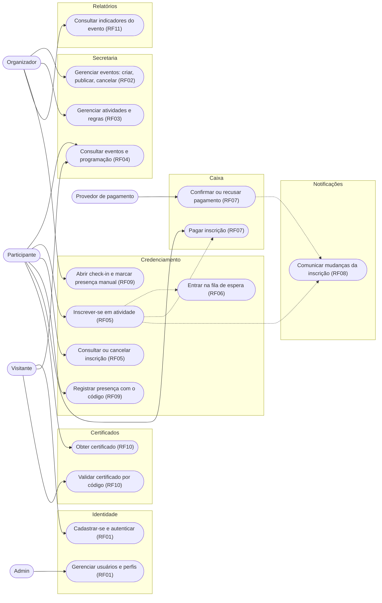
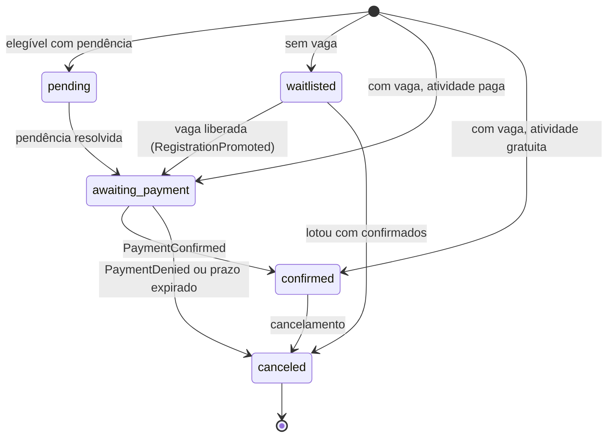
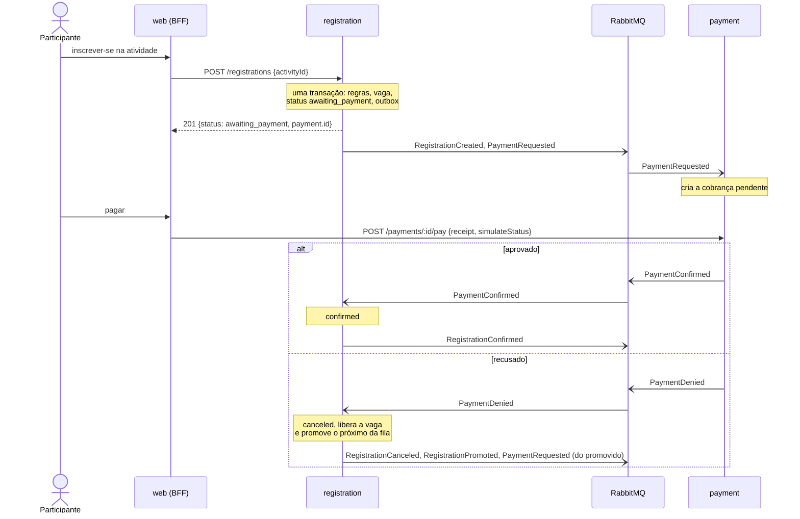

# EventHub: relatório arquitetural

## 1. Resumo

O EventHub é uma plataforma de gestão de eventos acadêmicos e profissionais usada por várias organizações. Este relatório responde à pergunta orientadora do trabalho: *quais capacidades de negócio devem virar serviços implantáveis de forma independente, e por quê?*

A resposta da equipe:

- **Sete serviços de domínio e um BFF:** Identidade, Secretaria, Credenciamento, Caixa, Certificados, Relatórios e Notificações.
- Vira serviço o que tem modelo próprio, outra equipe ou necessidade própria de escala ou disponibilidade.

O que a distribuição custou está na [seção 12](#12-reflexão-crítica-o-que-ganhamos-e-o-que-pagamos).

## 2. Metodologia

1. **Análise do texto.** Dos RFs, RNs e RQs saíram os substantivos e verbos do domínio, depois os subdomínios e os contextos (*use cases → subdomínios → bounded contexts → sistemas*, como em Context Mapper).
2. **Brainstorm** da equipe sobre fronteiras e mensagens. O primeiro rascunho tinha nove candidatos, com Catálogo público e Fila como serviços próprios.
3. **Conversa com especialista em organização de eventos.** Dela veio a linguagem dos contextos: Secretaria, Credenciamento, Caixa, Portaria.
4. **Revisão da literatura** (seção 14): decomposição, padrões de comunicação, Saga, DDD.
5. **Refinamento com IA** (seção 13) e registro de cada decisão em ADR, com gatilho de revisão.

O critério de granularidade usado em todas as decisões: uma fronteira só existe se houver **modelo e linguagem próprios**, **outra equipe**, ou **necessidade própria de escala ou disponibilidade**. Um RF não vira serviço automaticamente.

## 3. Análise das forças

As forças estão em ordem de prioridade.

| # | Força | Requisitos | Como a arquitetura responde | Trade-off aceito |
|---|---|---|---|---|
| 1 | Integridade das regras de negócio | RN01, RN02, RN03, RQ04 | Vaga e inscrição no mesmo agregado; capacidade em três camadas (domínio, lock otimista, trigger); evento imutável após a publicação | Latência maior sob disputa; erro em evento publicado exige cancelar e republicar |
| 2 | Isolamento de falhas e autonomia | RN05, RQ03 | Coreografia por eventos, sem HTTP entre domínios; banco por serviço; JWT validado localmente | Consistência eventual; dados duplicados em projeções |
| 3 | Simplicidade e custo proporcional (YAGNI) | prazo do projeto | SQLite no protótipo, RabbitMQ em vez de Kafka, sem API gateway, sem serviço de catálogo, check-in dentro do Credenciamento | Escala e alta disponibilidade adiadas, cada uma com gatilho explícito |
| 4 | Escalabilidade seletiva | RQ02 | Escala por contexto; a fila absorve picos; cache no catálogo público | No protótipo, serviço com SQLite roda com uma instância |
| 5 | Evolução independente | RQ01, RQ05 | Contratos em JSON Schema e OpenAPI; aceita consumidores novos sem mudar produtores | Contrato de mensagem vira API pública |

Duas forças vieram da experiência da equipe:

- **Divisão do trabalho.** Serviços separados facilitaram distribuir tarefas. Em troca, os contratos tiveram de ser definidos enquanto o domínio ainda estava sendo entendido, e mudaram várias vezes (por exemplo, a adoção tardia do envelope nas mensagens).
- **Tempo do projeto.** O prazo curto reforçou a força 3: construir só o que um requisito pede.

**Leitura geral:** correção > disponibilidade > desempenho. O projeto aceita consistência eventual e latência para nunca violar invariantes nem acoplar a disponibilidade dos serviços. A escala está desenhada, mas só entra quando uma métrica real justificar.

## 4. Decomposição

| Contexto | Serviço | RFs | Tecnologia |
|---|---|---|---|
| Identidade | `identity` | RF01 | Node/Express, Postgres |
| Secretaria | `secretariat` | RF02, RF03, RF04 | Node/Express, SQLite |
| Credenciamento | `registration` | RF05, RF06, RF09 | Node/Express, SQLite |
| Caixa | `payment` | RF07 | Python/FastAPI, SQLite |
| Certificados | `certificate` | RF10 | Python/FastAPI, SQLite |
| Relatórios | `reports` | RF11  | Python/FastAPI, SQLite |
| Notificações | `notification` + `notification-worker` | RF08  | Python/FastAPI, SQLite, SMTP (Mailpit no ambiente local) |
| Monitoramento | infraestrutura | RQ06 | — |
| Front | `web` (BFF) | telas | Node/Express/EJS |

Diagrama RF → contexto → eventos: [diagrams/arquitetura.md](diagrams/arquitetura.md).

### Por que essas fronteiras

| Decisão | Justificativa | ADR |
|---|---|---|
| RF02, RF03 e RF04 juntos na **Secretaria** | Um catálogo separado só copiaria o modelo da Secretaria, sem linguagem nem regra própria. O pico de leitura se resolve com cache, porque o conteúdo publicado é imutável | [002](adrs/002-catalogo-publico.md) |
| RF05 e RF06 juntos no **Credenciamento** | Vaga ocupada *é* o status da inscrição. Separar exigiria saga para proteger a invariante que mais importa (RN01) | [003](adrs/003-controle-de-vagas-no-credenciamento.md) |
| RF09 (check-in) no **Credenciamento** | Depende do status da inscrição, que já está lá. Fica em agregados próprios (`CheckIn`, `Attendance`) para não disputar o lock das inscrições | [006](adrs/006-forma-do-checkin.md) |
| **Caixa** separado | Depende de um provedor externo lento e instável. A falha dele não pode parar as inscrições | [001](adrs/001-comunicacao-assincrona.md) |
| **Certificados** e **Notificações** separados | RQ01 pede implantação independente; RQ02 diz que certificados ficam quase ociosos; RQ03 e RN05 pedem que a falha deles não afete a inscrição | [008](adrs/008-certificados.md), [009](adrs/009-notificacoes.md) |
| **Relatórios** separado | É um modelo de leitura (CQRS) com consultas agregadas. Pode cair sem afetar a operação (RQ03) | — |
| **Fila de acesso** não é serviço | Não tem linguagem nem regra de negócio: é infraestrutura de borda | [005](adrs/005-fila-de-acesso.md) |

Cada junção tem um gatilho para ser desfeita. As subdivisões previstas estão em [arquitetura.md](arquitetura.md#subdivisões-possíveis): check-in, leitura do catálogo, processamento serial de inscrições.

## 5. Diagramas

### 5.1 Casos de uso

As setas tracejadas são casos disparados por outro caso, sem ação do ator.

### 5.2 Estados da inscrição

`pending`, `awaiting_payment` e `confirmed` ocupam vaga. A soma deles nunca passa de `capacity`.

## 6. Dados

Nenhum serviço lê o banco de outro (*Database per Service*).

| Serviço | Dados próprios | Projeções (origem) | Acesso |
|---|---|---|---|
| `identity` | `User` | — | O próprio usuário; rotas `/internal` com token de serviço |
| `secretariat` | `Event`, `Activity`, regras | — | Escrita: organizadores do evento. Leitura pública: `/public/events`, só eventos publicados |
| `registration` | `Registration`, `CheckIn`, `Attendance` e a ocupação da atividade | `Activity` e `Event`; `Participant` (`UserRegistered`) | Participante vê as próprias inscrições; organizador, as do seu evento |
| `payment` | `Payment` | — (guarda só `registrationId`) | Usuário autenticado |
| `certificate` | `Certificate` | — | Validação pública por código |
| `reports` | — | Todas, a partir dos eventos de domínio | Organizador do evento |
| `web` | — (caches em memória, descartáveis) | — | — |

Três formas de compartilhamento são usadas, da preferida para a menos preferida:

1. **Projeção por evento**, só com os campos necessários. A autorização do organizador no `registration` é local, sem chamar a Secretaria.
2. **Mensagem autossuficiente.** O `CertificateRequested` leva nome, evento e atividades, e o `certificate` não precisa de projeção.
3. **API síncrona**, só para o BFF.

Persistência: SQLite por serviço no protótipo e Postgres por serviço em produção ([ADR 000](adrs/000-escolha-banco.md)).

## 7. Comunicação e contratos

### 7.1 Síncrona ou assíncrona

| Tipo | Onde | Por quê |
|---|---|---|
| HTTP/REST síncrono | navegador → `web` → serviços | O usuário espera a resposta. O BFF compõe as telas e repassa o JWT |
| Eventos assíncronos (publish/subscribe) | entre serviços de domínio | Isola falhas e absorve picos. O produtor não conhece o consumidor |
| Comando assíncrono | `PaymentRequested` (registration → payment) | Tem destinatário único, mas não precisa de resposta imediata |

Nenhum serviço de domínio chama outro por HTTP. A validação do JWT é local.

### 7.2 Contratos (RQ05)

- **Mensagens:** um JSON Schema por mensagem em [microservices/contracts/messages](../microservices/contracts/messages/), com o catálogo de produtor, consumidor e regra de idempotência em [contracts/README.md](../microservices/contracts/README.md).
- **Envelope:** `{id, type, source, time, data}`, subconjunto do CloudEvents 1.0.
- **HTTP:** `openapi.yaml` por serviço Node, com Swagger em `/docs`; OpenAPI gerado pelo FastAPI nos serviços Python.
- **Evolução:** leitor tolerante (campos desconhecidos são ignorados). Campo novo opcional não quebra. Mudança incompatível cria um tipo novo (`EventPublishedV2`).

### 7.3 Erros e idempotência

| Mecanismo | O que resolve |
|---|---|
| **Transactional Outbox** | Estado e mensagem gravados na mesma transação. Com o broker fora do ar, as mensagens esperam no banco |
| **Inbox** (consumidor idempotente) | A entrega é *pelo menos uma vez*. O `id` do envelope descarta repetidas |
| **Handlers idempotentes** | Segunda defesa: upsert, "ignora se já existe", `paymentId` gerado por quem pede |
| **Retry e DLQ** | Falha do handler: 5 tentativas com 5 s de intervalo, depois `<fila>.dlq` |
| **Publisher confirms, filas duráveis, `ack` manual** | Não perder mensagem no broker |

## 8. Padrões

| Padrão | Decisão | Motivo |
|---|---|---|
| Database per Service | **Adotado** | Autonomia e evolução independente (RQ01) |
| Publish/Subscribe | **Adotado** | Isolamento de falhas (RQ03, RN05); consumidores novos sem mudar produtores |
| Transactional Outbox | **Adotado** (serviços Node) | Sem ele, uma queda entre o commit e a publicação perderia a mensagem e deixaria a reserva presa (RQ04) |
| Idempotent Consumer | **Adotado** | Consequência da entrega pelo menos uma vez |
| Backend for Frontend | **Adotado** | Um único cliente (navegador). As composições são de tela |
| Saga coreografada | **Adotado**, de forma implícita | O fluxo reserva → pagamento → confirmação é uma sequência de eventos com compensação (cancelar e promover a fila) |
| CQRS | **Adotado** só no `reports` | Leitura agregada separada da escrita |
| Saga orquestrada | **Descartado** | O fluxo tem três passos e cada um tem dono claro. Um orquestrador concentraria regra de vários contextos |
| API Gateway | **Adiado** | Duplicaria o BFF. Gatilho: cliente fora do navegador ([ADR 007](adrs/007-entrada-unica-sem-api-gateway.md)) |
| Circuit Breaker | **Não adotado** | Não há chamada síncrona entre serviços de domínio. |
| Event Sourcing | **Descartado** | Nenhum requisito pede histórico reconstruível. Custo: o `reports` não se reconstrói do zero |

## 9. Fluxo de inscrição paga

### 9.1 Caminho principal e recusa

A inscrição só fica `confirmed` depois do `PaymentConfirmed` (RN02). A recusa libera a vaga sem confirmar (RN03).

### 9.2 Comportamento nas falhas

| Cenário | O que acontece | Requisito |
|---|---|---|
| **Pagamento recusado** | `PaymentDenied` → inscrição `canceled`, vaga liberada, o primeiro da fila é promovido e recebe a própria cobrança | RN03, RN04 |
| **Timeout (não pagou)** | Um job do `registration` roda a cada minuto e cancela reservas com mais de `PAYMENT_WINDOW_MINUTES` (padrão 2, para demonstração) com o motivo `Payment expired`. O `payment` recusa pagar uma cobrança vencida | RN02 |
| **Pagamento atrasado ou duplicado** | O `registration` só aceita `PaymentConfirmed` com o `paymentId` da reserva atual. O resto é ignorado | RQ04 |
| **`payment` fora do ar** | A inscrição continua funcionando. O `PaymentRequested` espera na fila durável. A tela de pagamento mostra erro controlado e o resto do site segue no ar; o participante não consegue pagar até o serviço voltar, e a reserva pode expirar. Coberto pelo e2e [falha-dependencia.spec.js](../microservices/e2e/tests/falha-dependencia.spec.js) | RQ03 |
| **RabbitMQ fora do ar** | A inscrição é gravada com a mensagem no outbox. O relay reenvia a cada segundo quando o broker volta, na ordem | RQ04 |
| **Notificações, certificados ou relatórios fora do ar** | Nenhum efeito na inscrição: nada espera resposta deles. As mensagens ficam na fila de cada um | RN05, RQ03 |
| **Handler falha ao tratar a mensagem** | Retry (5 vezes), depois DLQ para inspeção e reprocessamento | RQ04, RQ06 |
| **Projeção atrasada** | Logo após o cadastro, a inscrição pode falhar com `user not found` até o `UserRegistered` chegar. O usuário tenta de novo | custo da consistência eventual |
| **Disputa pela última vaga** | Lock otimista: quem perde recarrega e refaz (até 20 vezes). Esgotou, devolve 409 sem exceder a capacidade | RN01 |

## 10. ADRs

O projeto tem onze ADRs em [adrs/](adrs/). Os cinco abaixo são os que mais moldaram a arquitetura.

### ADR 001: integração por eventos, sem chamadas síncronas entre domínios

- **Contexto:** os fluxos atravessam contextos e os picos caem em serviços diferentes. A queda de um não pode derrubar os outros (RQ03, RN05).
- **Alternativas:** HTTP síncrono entre serviços; Kafka; saga orquestrada; banco compartilhado.
- **Decisão:** coreografia por eventos no RabbitMQ, com outbox, inbox, retry e DLQ. HTTP só no BFF.
- **Justificativa:** isola falhas, a fila absorve picos e o produtor não conhece o consumidor. O RabbitMQ entrega retry, DLQ e roteamento prontos; o log retido do Kafka não é requisito.
- **Evidências:** `certificate` e `reports` entraram ouvindo eventos que já existiam, sem mudança nos produtores. O teste e2e passa pelo fluxo assíncrono completo, e o e2e de falha mostra a inscrição funcionando com o `payment` parado.
- **Consequências:** consistência eventual; handlers idempotentes; fluxo difícil de seguir sem id de correlação; contrato de mensagem vira API pública; o RabbitMQ não guarda histórico.
- [Texto completo](adrs/001-comunicacao-assincrona.md)

### ADR 002: catálogo público na Secretaria, com cache

- **Contexto:** o primeiro desenho tinha um serviço de Catálogo que projetava quase todos os campos de `Event` e `Activity`. A única razão para existir era o pico de leitura na abertura das inscrições (RF04, RQ02).
- **Alternativas:** catálogo como serviço próprio; réplicas de leitura do banco; cache compartilhado (Redis) no BFF; invalidação por evento, sem TTL.
- **Decisão:** a Secretaria expõe a leitura pública em `/public/events`, sem login e só com eventos publicados. O pico se resolve com cache em três camadas: `Cache-Control` e `ETag` na Secretaria, micro-cache no BFF e CDN quando houver pico real.
- **Justificativa:** o catálogo não tem modelo nem linguagem próprios, é a programação da Secretaria vista de fora. O conteúdo publicado é imutável, então o cache acerta quase sempre.
- **Evidências:** `GET /public/events` e `/public/events/:id` no `secretariat`, consumidos pelo `web`. As camadas de cache estão propostas, não implementadas.
- **Consequências:** um cancelamento leva até cerca de 60 s para aparecer no catálogo. As páginas públicas do BFF deixam de depender da sessão. Gatilho: cache insuficiente (extrair um deployable de leitura alimentado pelo `EventPublished`).
- [Texto completo](adrs/002-catalogo-publico.md)

### ADR 003: controle de vagas como regra do Credenciamento

- **Contexto:** a capacidade não pode ser excedida mesmo com muitas inscrições simultâneas e várias instâncias (RN01, RQ04).
- **Alternativas:** microsserviço de vagas; lock pessimista; contador atômico no banco.
- **Decisão:** a `Activity` é o agregado que decide a vaga e a única porta de escrita das inscrições. Três camadas: domínio, lock otimista (`version`) e trigger no banco.
- **Justificativa:** vaga e inscrição são o mesmo conceito e precisam mudar na mesma transação. Em serviços separados, isso exigiria saga, e entre os passos a capacidade poderia ser excedida.
- **Evidências:** `concurrency.test.js` (8 conexões, 200 inscrições, 30 vagas) termina com ocupação 30 e 170 na fila de espera. Um segundo teste confirma que o trigger recusa a vaga excedente.
- **Consequências:** o Credenciamento concentra inscrição, capacidade e fila. Atividade muito disputada tem latência maior pelas tentativas repetidas. Gatilho: disputa que o lock não absorva (contador atômico ou processamento serial).
- [Texto completo](adrs/003-controle-de-vagas-no-credenciamento.md)

### ADR 006: check-in no Credenciamento, por código da atividade

- **Contexto:** o RF09 pede registrar a presença sem duplicidade. A presença alimenta o comparecimento (RF11) e os certificados (RN06). Não é controle de entrada: ninguém é barrado na porta.
- **Alternativas:** microsserviço de check-in; check-in dentro do agregado `Activity`; ingresso assinado (QR) conferido por porteiro; código rotativo (TOTP); geolocalização; só marcação manual.
- **Decisão:** fica no `registration`, em agregados próprios (`CheckIn`, `Attendance`). O organizador abre o check-in e mostra um código na sala; o participante logado informa o código. Há marcação manual pelo organizador. Cada presença nova publica `AttendanceRegistered`.
- **Justificativa:** o check-in depende do status da inscrição, que já está no `registration`; em outro serviço, isso viraria projeção. O código prova a presença na sala sem porteiro nem leitor. A unicidade por `registrationId` no banco impede duplicidade.
- **Evidências:** `checkin.test.js` no `registration`. O `registration` usa a presença para emitir o `CertificateRequested` no fim do evento.
- **Consequências:** carga alta no check-in afeta as inscrições. Um código repassado durante a abertura permite presença indevida. Gatilhos para extrair: operação offline com leitores de QR, pico na abertura das atividades, outra equipe operando o check-in.
- [Texto completo](adrs/006-forma-do-checkin.md)

### ADR 007: entrada única pelo BFF, sem API gateway

- **Contexto:** o único cliente é o navegador, que só fala com o `web`. Na borda, o que se pede é TLS, rate limit e cache.
- **Alternativas:** API gateway (Kong, AWS); composição no gateway (GraphQL federation); BFF JSON compartilhado.
- **Decisão:** sem gateway. Os serviços ficam na rede interna e um proxy reverso de configuração fica na frente do `web`. Cada serviço continua validando o JWT.
- **Justificativa:** com um cliente só, o gateway duplicaria o BFF e seria mais um componente para escalar no pico.
- **Evidências:** no `docker-compose.yml`, os serviços de domínio do fluxo principal não publicam porta.
- **Consequências:** toda tela passa pelo BFF. Gatilho: cliente fora do navegador.
- [Texto completo](adrs/007-entrada-unica-sem-api-gateway.md)

## 11. Validação

### 11.1 Protótipo

Sete serviços implementados. Fluxo de ponta a ponta com cinco serviços: consulta de atividade (`web` + `secretariat`) → reserva de vaga (`registration`) → pagamento simulado (`payment`) → confirmação (`registration`) → check-in → certificado (`certificate`). Execução: [microservices/README.md](../microservices/README.md).

### 11.2 Testes executados em 2026-11-13

| Suíte | Comando | Resultado |
|---|---|---|
| `registration` (domínio, API, repositório, concorrência, check-in, certificados) | `cd microservices/registration && npm test` | 39 de 39 |
| `secretariat` | `cd microservices/secretariat && npm test` | 11 de 11 |
| `shared` (outbox, retry/DLQ, repositório) | `cd microservices/shared && node --test` | 7 de 7 |
| `web` (BFF) | `cd microservices/web && npm test` | 18 de 18 |
| `identity` | `cd microservices/identity && npm test` | 2 de 2 |
| `contracts` (mensagens contra os schemas) | `cd microservices/contracts && npm test` | 6 de 6 |
| `payment` (Python) | `cd microservices/payment && uv run pytest` | 9 de 9 |
| `notification` (Python) | `cd microservices/notification && uv run pytest` | 25 de 25 |
| `certificate` (Python) | `python -m pytest` | 39 de 39 |
| `reports` (Python) | `python -m pytest` | 70 de 70 |
| e2e (fluxo principal e falha de dependência) | `cd microservices/e2e && npm test` | 2 de 2 |

### 11.3 Fluxo inscrição, concorrência, falhas e integração

| Item | Evidência | Situação |
|---|---|---|
| Fluxo principal e estados da inscrição | [e2e/tests/fluxo.spec.js](../microservices/e2e/tests/fluxo.spec.js): organizador publica evento pago; participante se cadastra, se inscreve e paga | Automatizado, passou |
| Concorrência sem exceder a capacidade | [registration/test/concurrency.test.js](../microservices/registration/test/concurrency.test.js) | Executado, passou |
| Falha de dependência: pagamento recusado | Botão "Simular compra negada" na tela de pagamento (`simulateStatus: denied` em `POST /payments/:id/pay`); testes de domínio do `registration` cobrem cancelamento e promoção da fila | Coberto por teste de unidade; roteiro manual pela tela |
| Falha de dependência: serviço indisponível | [e2e/tests/falha-dependencia.spec.js](../microservices/e2e/tests/falha-dependencia.spec.js): `docker compose stop payment`, inscrição funciona, tela de pagamento mostra erro controlado, `docker compose start payment` e a compra é concluída com o `PaymentRequested` que esperou na fila | Automatizado, passou. |
| Integração entre tecnologias distintas | `registration` (Node) ↔ `payment` e `certificate` (Python) por mensagens com envelope | Em uso no compose |

## 12. Reflexão crítica: o que ganhamos e o que pagamos

### O que ganhamos

- **Isolamento de falhas real.** Pagamento, certificados e relatórios podem cair sem parar a inscrição.
- **Evolução independente comprovada.** `certificate` e `reports` foram acrescentados sem tocar nos produtores.
- **Interoperabilidade.** Quatro serviços em Python e três em Node (mais o BFF), integrados só por contrato.
- **Escala seletiva desenhada.** Cada contexto tem gargalo, forma de escalar e gatilho definidos ([arquitetura.md](arquitetura.md#escala)).
- **Trabalho em paralelo.** Cada pessoa cuidou de um serviço.

### O que pagamos

- **Consistência eventual visível ao usuário.** O `user not found` logo após o cadastro; a posição na fila com alguns segundos de atraso; o teste e2e precisa repetir passos até as mensagens chegarem.
- **Complexidade de mensageria.** Outbox, inbox, retry, DLQ e envelope são código que um monólito não teria.
- **Garantias desiguais entre tecnologias.** O que o bus Node resolve teve de ser refeito em Python, e ficou incompleto.
- **Contratos caros de mudar.** A adoção do envelope exigiu alterar todos os serviços.
- **Rastreio difícil.** Sem id de correlação, seguir uma inscrição exige procurar por `registrationId` nos logs de cada serviço (RQ06 atendido só em parte).
- **Dados duplicados.** Projeções com nome e e-mail em vários serviços complicam a exclusão de dados pessoais (LGPD).
- **Operação.** Doze contêineres para subir o ambiente local (serviços, worker de notificações, RabbitMQ, Postgres e Mailpit).

### Decisões que evitaram custo

Não separar vagas, check-in, catálogo e fila de acesso evitou sagas e projeções em quatro pontos. A mesma regra que justificou sete serviços impediu que fossem onze.

## 13. Uso de IA generativa

A IA foi usada como apoio, e a equipe revisou o que foi produzido:

- **Estudo:** DDD e microserviços.
- **Exploração de alternativas:** por exemplo, separação de leitura e escrita (um serviço ou dois; um banco, dois com sincronia por eventos, ou réplicas), que levou ao [ADR 002](adrs/002-catalogo-publico.md).
- **Implementação e revisão** de código, testes e documentação.

## 14. Referências

- Newman, S. *Building Microservices: Designing Fine-Grained Systems*. O'Reilly Media, Inc., 2021.
- Abgaz, Y. et al. *Decomposition of Monolith Applications Into Microservices Architectures: A Systematic Review*. IEEE Transactions on Software Engineering 49.8 (2023): 4213-4242.
- Velepucha V, Flores P. *A survey on microservices architecture: Principles, patterns and migration challenges.* IEEE access. 2023.
- Taibi, D.; Lenarduzzi, V.; Pahl, C. *Architectural Patterns for Microservices: A Systematic Mapping Study*. CLOSER 2018: Proceedings of the 8th International Conference on Cloud Computing and Services Science; Funchal, Madeira, Portugal, 19-21 March 2018. SciTePress, 2018.
- Waseem, M. et al. *Decision Models for Selecting Patterns and Strategies in Microservices Systems and their Evaluation by Practitioners*. Proceedings of the 44th International Conference on Software Engineering: Software Engineering in Practice. 2022.
- Kapferer, S.; Zimmermann, O. *Domain-driven Architecture Modeling and Rapid Prototyping with Context Mapper*. International Conference on Model-Driven Engineering and Software Development. Cham: Springer International Publishing, 2020.
- Bellundagi, M. *Design and Implementation of Scalable Microservices Architecture for Digital Payment Systems.* International Journal of Engineering & Extended Technologies Research (IJEETR) 4.4 (2022): 5048-5054.
- Zhang, Z., Zhang, X., & Li, X. *Securing High-Concurrency Ticket Sales: A Framework Based on Microservice*. arXiv preprint arXiv:2512.24941 (2025).
- Richardson, C. *Pattern: Saga* e *Microservice Architecture pattern*. microservices.io.
- Stemmler, K. *An Introduction to Domain-Driven Design (DDD)*. Disponível em: <https://khalilstemmler.com/articles/domain-driven-design-intro/>.
- Kong Inc. *What are Microservices?* Disponível em: <https://konghq.com/blog/learning-center/what-are-microservices>.
- Walker, J. *Guia Completo sobre Architecture Decision Records (ADR): definição e melhores práticas*. Medium. Disponível em: <https://medium.com/@jhonywalkeer/guia-completo-sobre-architecture-decision-records-adr-defini%C3%A7%C3%A3o-e-melhores-pr%C3%A1ticas-f63e66d33e6>.
- CloudEvents. *CloudEvents Specification, version 1.0*. Cloud Native Computing Foundation. Disponível em: <https://github.com/cloudevents/spec/blob/v1.0/spec.md>.