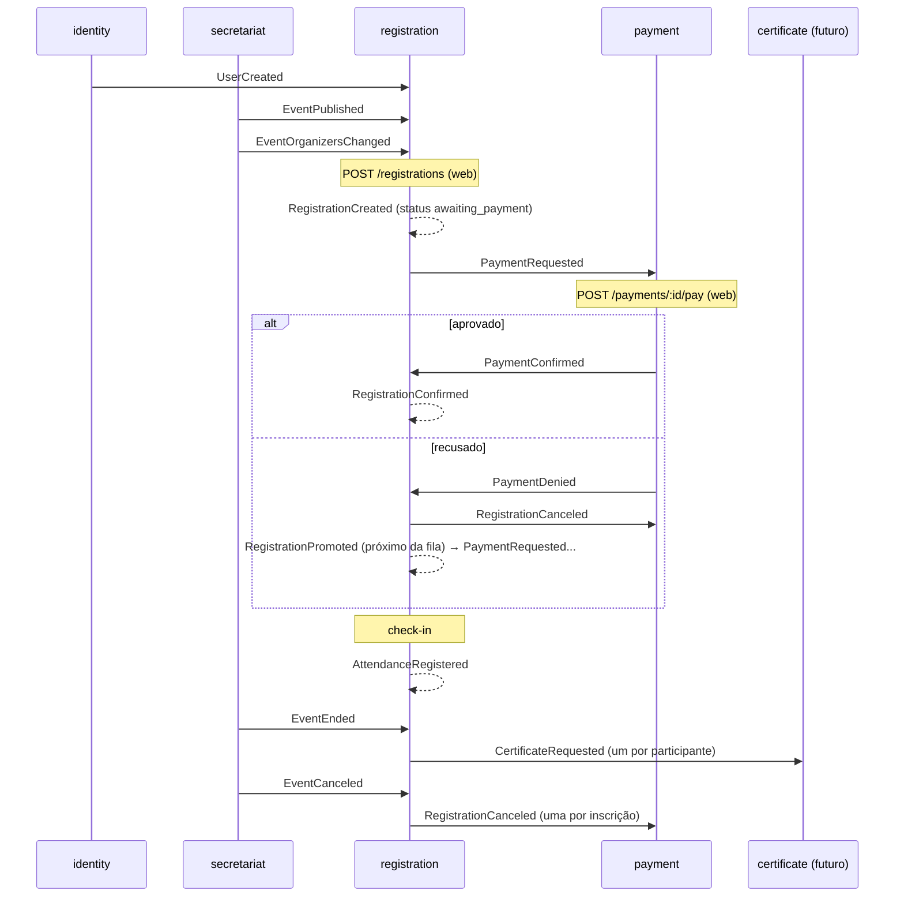

# Contratos entre serviços (RQ05)

- Mensagens: JSON Schema (draft 2020-12), um arquivo por mensagem em [messages/](messages/). Os campos comuns ficam em [envelope.schema.json](messages/envelope.schema.json).
- HTTP: o `openapi.yaml` de cada serviço (ver [HTTP](#http-síncrono)).
- Teste: `cd contracts && npm i && npm test` valida os exemplos dos schemas e as mensagens que os domínios atuais geram ([test/messages.test.js](test/messages.test.js)). Se mudar uma mensagem, mude o schema junto.

## Transporte (RabbitMQ)

| Item | Valor |
|------|-------|
| Exchange | `event-hub`, tipo `topic`, durável |
| Routing key | o nome da mensagem (`type`), ex.: `PaymentRequested` |
| Propriedades AMQP | `persistent: true`, `contentType: application/json`; `messageId`, `type` e `appId` iguais a `id`, `type` e `source` do envelope |
| Corpo | JSON em UTF-8: o envelope, com o conteúdo da mensagem em `data` |
| Fila do consumidor | uma fila durável por serviço, com o nome do serviço (`identity`, `payment`, `registration`, `secretariat`), ligada (bind) à exchange com uma routing key por tipo que ele ouve |
| Retry | se o handler falha, a mensagem vai para `<fila>.retry` (TTL `MESSAGE_RETRY_DELAY_MS`, padrão 5000 ms), que a devolve para `<fila>`. Header `x-attempt` (começa em 1) e `x-error` |
| DLQ | depois de `MESSAGE_MAX_ATTEMPTS` (padrão 5) tentativas, vai para `<fila>.dlq` |
| Consumo | `prefetch 1`, `ack` só depois de tratar |

### Envelope

Toda mensagem tem metadados no envelope e o conteúdo em `data` ([envelope.schema.json](messages/envelope.schema.json)):

```json
{
  "id": "0b9c6c1e-3f0a-4d38-9d2e-6f1c2a7b8e01",
  "type": "PaymentRequested",
  "source": "registration",
  "time": "2026-11-06T13:00:00.000Z",
  "data": { "paymentId": "…", "registrationId": "…", "userId": "…", "amount": 50, "description": "Ticket" }
}
```

| Campo | Para quê |
|-------|----------|
| `id` | UUID novo por mensagem: idempotência (inbox) |
| `type` | nome da mensagem: roteamento e escolha do schema |
| `source` | serviço que publicou: rastreio e logs. Cada tipo tem um único `source` |
| `time` | quando o fato aconteceu (gravação no outbox) |
| `data` | conteúdo; o schema de cada tipo o define |

- Os nomes são um subconjunto do [CloudEvents](https://cloudevents.io) 1.0 (modo estruturado). Para ficar conforme, basta acrescentar `specversion: "1.0"`. Ficaram de fora, por enquanto, `specversion`, `datacontenttype`, `dataschema` e `subject`.
- Separar `data` evita colisão de nomes entre o envelope e o domínio (ex.: o `id` da inscrição em `RegistrationCreated`) e deixa o envelope igual para todas as mensagens.
- Os handlers recebem `(data, envelope)` ([rabbitmq-message-bus.js](../shared/messaging/rabbitmq-message-bus.js)). Mensagem sem `data` falha e vai para a DLQ.

Obrigações de quem implementa um serviço:

- **Produtor:** grava a mensagem na mesma transação do estado (outbox) e só a apaga quando o broker confirmar (publisher confirms). Gera um `id` novo (UUID) por mensagem.
- **Consumidor:** a entrega é *pelo menos uma vez*. Guarde os `id` já tratados e ignore os repetidos (inbox), e mantenha os handlers idempotentes (ver a coluna "Idempotência" abaixo).
- **Tolerant reader:** ignore campos desconhecidos. Os schemas não usam `additionalProperties: false`. Campo novo e opcional não quebra o contrato. Remover ou renomear um campo, ou torná-lo obrigatório, quebra: nesse caso, crie um tipo novo (ex.: `EventPublishedV2`).
- Mensagem inválida: lance erro no handler para que ela vá para a DLQ. Não faça `ack` em silêncio.
- Correlação (RQ06): ainda não há. Quando houver, entra como campo do envelope (ex.: `correlationid`, extensão do CloudEvents), não em `data`.

## Mensagens

| Mensagem | Produtor → consumidor | O consumidor deve | Idempotência |
|----------|-----------------------|-------------------|--------------|
| [UserCreated](messages/UserCreated.schema.json) | identity → registration | criar/atualizar o participante (`userId`, `username`) | upsert |
| [UserUpdated](messages/UserUpdated.schema.json) | identity → registration | idem. **Reservado:** o registration já ouve, mas o identity ainda não publica | upsert |
| [EventPublished](messages/EventPublished.schema.json) | secretariat → registration | criar a cópia imutável do evento e das atividades e abrir as inscrições | ignora evento/atividade que já existe |
| [EventOrganizersChanged](messages/EventOrganizersChanged.schema.json) | secretariat → registration | substituir a lista de organizadores (lista completa, não delta) | sobrescreve |
| [EventCanceled](messages/EventCanceled.schema.json) | secretariat → registration | cancelar todas as inscrições, emitindo `RegistrationCanceled` para cada uma | ignora evento desconhecido ou já cancelado |
| [EventEnded](messages/EventEnded.schema.json) | secretariat → registration | encerrar o evento, bloquear o check-in e emitir `CertificateRequested` | só age se o evento estiver `published` |
| [PaymentRequested](messages/PaymentRequested.schema.json) | registration → payment | criar a cobrança pendente com o `paymentId` recebido | ignora `paymentId` existente |
| [RegistrationCanceled](messages/RegistrationCanceled.schema.json) | registration → payment | cancelar as cobranças pendentes da inscrição | cancelar o que já foi cancelado não muda nada |
| [PaymentConfirmed](messages/PaymentConfirmed.schema.json) | payment → registration | confirmar a inscrição se ela ainda espera esse `paymentId` | ignora se não espera mais |
| [PaymentDenied](messages/PaymentDenied.schema.json) | payment → registration | cancelar a inscrição se ela ainda espera esse `paymentId`. A vaga passa para o próximo da fila | ignora se não espera mais |
| [RegistrationCreated](messages/RegistrationCreated.schema.json) | registration → (ninguém ainda) | futuro: notificações e relatórios | — |
| [RegistrationPromoted](messages/RegistrationPromoted.schema.json) | registration → (ninguém ainda) | futuro: notificações | — |
| [RegistrationConfirmed](messages/RegistrationConfirmed.schema.json) | registration → (ninguém ainda) | futuro: notificações | — |
| [AttendanceRegistered](messages/AttendanceRegistered.schema.json) | registration → (ninguém ainda) | futuro: relatórios | — |
| [CertificateRequested](messages/CertificateRequested.schema.json) | registration → certificate (futuro, ADR 003) | emitir o certificado | por `requestId` (`<eventId>:<userId>`) |

Consequências para quem implementa:

- O **secretariat** não ouve nada e o **identity** também não. As filas deles existem, mas ficam sem bind.
- Comandos e eventos usam o mesmo transporte. `PaymentRequested` é um comando com um único destinatário, o payment. As demais mensagens são eventos.
- O `paymentId` é gerado pelo registration, e não pelo payment. Assim o registration sabe qual pagamento espera, e uma resposta atrasada de uma cobrança antiga é ignorada.
- Em `RegistrationCreated`, o id da inscrição vem em `data.id`, e não em `data.registrationId` (é o `toJSON()` da entidade). Corrigir isso quebra o contrato.
- O prazo para pagar (`awaiting_payment` → `canceled`, motivo `Payment expired`) é um job interno do registration. Não há mensagem do payment para isso: o payment só fica sabendo por `RegistrationCanceled`.

## Fluxos



Linhas tracejadas: mensagem publicada sem consumidor por enquanto.

## HTTP (síncrono)

Os serviços não se chamam por HTTP: só o `web` (BFF) chama os serviços. O contrato de cada um é o seu `openapi.yaml`, servido também em `/openapi.yaml` e `/docs`.

| Serviço | Contrato | Rotas usadas pelo web ([web/src/clients](../web/src/clients/)) |
|---------|----------|--------------------------------|
| identity | [openapi.yaml](../identity/src/openapi.yaml) | `POST /auth`, `GET /users`, `GET /users?username=` |
| payment | [openapi.yaml](../payment/src/openapi.yaml) | `GET /payments/:id`, `POST /payments/:id/pay {receipt}` |
| registration | [openapi.yaml](../registration/src/openapi.yaml) | inscrições, fila de espera, gestão, check-in ([registration.js](../web/src/clients/registration.js)) |

Autenticação: JWT HS256 com o `JWT_SECRET` compartilhado, enviado em `Authorization: Bearer`, com payload `{sub, username, role}` (`role`: `user` | `admin`) e validade de 8h. O identity emite o token e os demais o validam. Ver [README](../README.md#autenticação).

## Limitações e alternativas

- Os schemas foram escritos à mão a partir do código. O teste garante que o código atual os segue, mas só nos cenários que ele cobre.
- Os campos de data do secretariat (`startDate`, `endDate`, `startsAt`, `endsAt`) aceitam qualquer ISO 8601 (data ou data-hora). Por isso os schemas validam só que são `string`.
- Os consumidores não validam as mensagens contra os schemas em tempo de execução. Seria possível fazer isso no bus, com o custo de um validador em cada serviço.
- Alternativas: AsyncAPI (descreve canais, filas e bindings AMQP e pode referenciar estes mesmos schemas); um schema registry (Confluent/Apicurio) para versionar os contratos; ou Pact (testes de contrato dirigidos pelo consumidor), quando houver outro time consumindo.
